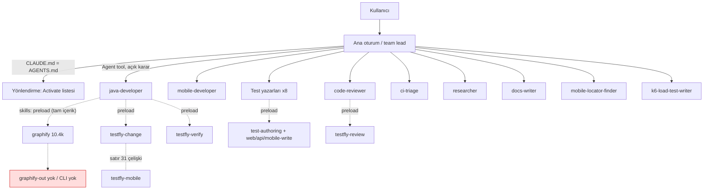
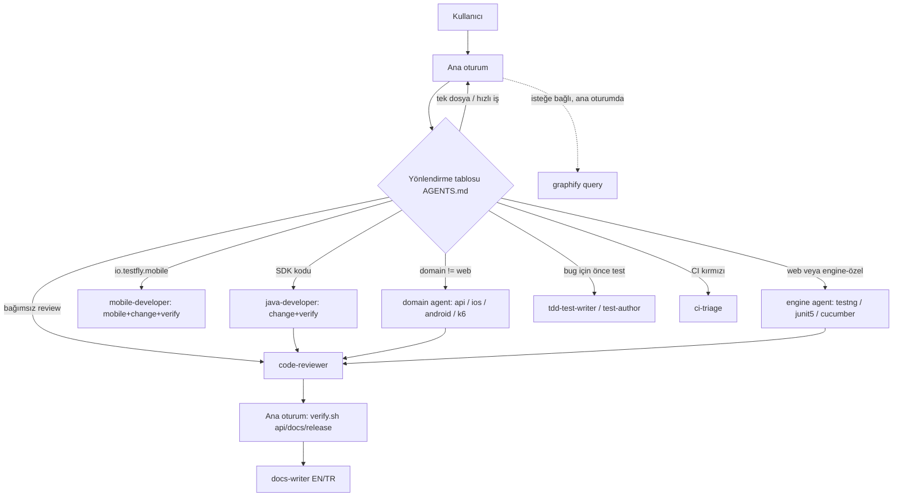

# TestFly — Agent Skills & Subagents Architecture Audit

- Tarih: 2026-10-25
- Dal: `development` (commit `ce348a8`), çalışma ağacında yalnızca bu rapor eklendi
- Claude Code sürümü: 2.1.310 (`claude --version`)
- Kapsam: 15 skill, 16 subagent, `AGENTS.md`/`CLAUDE.md`, `.claude/settings.json`, `scripts/agent/`, ADR 0001
- Revizyon: Bu rapor önce audit olarak yazıldı; aynı gün remediation uygulandı. **Bölüm 0 güncel durumu** verir. A-L bölümleri audit anındaki bulguları ve kanıtları korur ("audit anı"); durum için Bölüm 0'a bakın.
- Kural: Audit aşamasında uygulama kodu ve agent/skill tanımları değiştirilmedi. Remediation yalnızca agent altyapısını değiştirdi (`src/main`, testler ve Maven yapılandırması dokunulmadı).

## Kanıt sınıfları

| Etiket | Anlamı |
|---|---|
| **[V]** | Bu oturumda çalıştırıldı veya gözlendi (komut çıktısı, oturumun kendi Skill/Agent listesi) |
| **[S]** | Dosya içeriğinin statik okunması (dosya:satır belirtilir) |
| **[D]** | Resmi dokümantasyondan alıntıyla doğrulandı (2026-10-25'te çekildi) |
| **[NV]** | NOT VERIFIED. Çalıştırılamadı veya doğrulanamadı |

Token değerleri `bayt / 4` vekilidir ve yaklaşık ±25% hata payı vardır. Java tanımlayıcıları ve backtick yoğun metin gerçekte daha fazla token tutar. Bu bir ölçüm değil tahmindir.

---

## 0. Remediation Sonuçları (2026-10-25)

Mimari korundu: 15 skill, 16 subagent, engine/domain ayrımı, team-lead modeli, bağımsız code review. Yeni agent/skill eklenmedi, hiçbiri birleştirilmedi veya silinmedi. `graphify` vendor skill'i değiştirilmedi. Commit ve push yapılmadı: tüm değişiklikler çalışma ağacında.

### 0.1 Değişen dosyalar

| Alan | Dosyalar |
|---|---|
| Routing ve paylaşılan kurallar | `AGENTS.md` (routing tablosu, sahiplik kuralları, kısaltılmış Graphify), `CLAUDE.md` (artık yalnızca `@AGENTS.md` importu) |
| Subagent'lar (16) | `.claude/agents/*.md`: hepsinde ortak "Working rules" kısaltıldı ve "Skills to read first" satırı kaldırıldı. İçerik değişenler: `java-developer`, `mobile-developer`, `code-reviewer`, `researcher`, `ci-triage`, `tdd-test-writer`, `test-author`, `testng-test-writer`, `junit5-test-writer`, `cucumber-test-writer`, `api-test-writer`, `ios-test-writer`, `android-test-writer`, `k6-load-test-writer`, `mobile-locator-finder` |
| Skill'ler | `testfly-change`, `testfly-mobile`, `testfly-verify`, `testfly-review`, `testfly-triage`, `testfly-research`, `testfly-mobile-locator-finder`. `graphify` ve diğer 7 skill değişmedi |
| Güvenlik | `.claude/settings.json` (PreToolUse hook), yeni `scripts/agent/guard-subagent.py` |
| Doğrulama ve CI | `scripts/agent/validate.sh` (artık `validate_agents.py`'ye devreder), yeni `scripts/agent/validate_agents.py`, yeni `scripts/agent/test_agent_infra.py`, `scripts/agent/verify.sh` (`agent` modu testleri de çalıştırır), `.github/workflows/testfly-ci.yml` (yeni `agent-infrastructure` job'u) |
| Routing doğrulaması | yeni `scripts/agent/routing_check.py`, `routing_probe_hook.py`, `routing-scenarios.json` |
| Ölçüm | `scripts/agent/measure-context.sh` (eski mimariye sabitli `ace3c6a` baseline'ı yerine herhangi bir git ref'i ölçer) |

### 0.2 Audit bulgularının durumu

| # | Bulgu (audit anı) | Durum | Nasıl çözüldü / kanıt |
|---|---|---|---|
| 1 | `java-developer` `graphify` preload'ı (≈10.4k token) | **Çözüldü** | `skills:` yalnızca `testfly-change`, `testfly-verify`. Çağrı maliyeti ≈13.7k → ≈3.6k (bkz. 0.4) |
| 2 | `testfly-change:31` native mobile çelişkisi | **Çözüldü** | Satır düzeltildi, bridge sahipliği cümlesi eklendi. `rg "emulation"` yalnızca doğru bağlamda geçiyor |
| 3 | API+TestNG/Cucumber/JUnit routing çakışması | **Çözüldü** | `AGENTS.md` routing tablosu deliverable türü ve domain'i birlikte eşler, tek bir genel öncelik kuralı yok. Gerçek Claude Code çalıştırmasında 20/20 senaryo, ancak HEAD de 20/20 idi: iyileşme ölçülmedi (bkz. 0.5) |
| 4 | `AGENTS.md`'de `testfly-web-write` rotası yok | **Çözüldü** | Tabloda var. Validator her skill ve agent adının `AGENTS.md`'de geçmesini zorunlu kılıyor (fixture testi var) |
| 5 | testng/junit5 mobil iddiası ve skill uyuşmazlığı | **Çözüldü** | Mobil sınıflar `ios-test-writer`/`android-test-writer`'a yönlendirildi; testng/junit5 yalnızca web. Description'lar ve `skills:` tutarlı |
| 6 | Yetki sınırları yalnızca metinde | **Çözüldü, kalan risk var** | `guard-subagent.py` hook'u (0.6). Kalan risk 0.7'de |
| 7 | Agent doğrulaması CI'da yok, `validate.sh` zayıf | **Çözüldü (CI koşusu doğrulanmadı)** | Yeni `agent-infrastructure` job'u. GitHub Actions burada çalıştırılamadı **[NV]**; workflow YAML'ı ayrıştırıldı ve aynı komut yerelde geçti |
| 8 | `tdd-test-writer` geçersiz YAML | **Çözüldü** | Description yeniden yazıldı; validator artık katı YAML ayrıştırıyor ve bu sınıf hatayı yakalıyor (fixture testi) |
| 9 | `ci-triage`/`tdd` üretim kodu yetkisi | **Çözüldü** | Test/fixture/test-config defektini `ci-triage` düzeltir; `src/main` hook ile engelli, üretim değişikliği lead üzerinden `java-developer`/`mobile-developer`'a gider. `tdd` kırmızıda durur, yeşil adımı devreder |
| 10 | `researcher` `javap` / Bash uyuşmazlığı | **Çözüldü** | Skill ve agent metni: Bash yoksa komut "Unverified, needs a local check" olarak listelenir |
| — | `code-reviewer` "salt okunur" ama build çalıştırıyor | **Çözüldü** | Bash yalnızca salt okunur allowlist; Maven ve `verify.sh` lead'e taşındı (`testfly-review` güncellendi). Canlı doğrulandı (0.6) |
| — | `mobile-locator-finder` zararlı cihaz etkileşimi | **Kısmen çözüldü** | `Write` aracı kaldırıldı; hook uninstall/erase/reset/shutdown/data-clear/install komutlarını ve `/tmp` dışı yazmayı engelliyor; skill'e "Safe interaction rules" eklendi. Yıkıcı etiketli bir öğeye dokunmak hook ile tespit edilemez, yalnızca talimat |
| — | `k6-load-test-writer` gereksiz `api-write` | **Çözüldü** | Preload kaldırıldı (-835 token) |
| — | `CLAUDE.md` ≡ `AGENTS.md` kopyası | **Çözüldü** | `CLAUDE.md` `@AGENTS.md` importu. Gerçek oturumda hem ana oturum hem subagent import edilen içeriği biliyor (0.3). Validator kopyalamayı hata sayar |
| — | `validate.sh` sabit `15` / `rg` bağımlılığı | **Çözüldü** | Sayılar ağaçtan keşfediliyor; `rg` yerine Python |
| — | `measure-context.sh` eski baseline'a sabit | **Çözüldü** | Herhangi bir git ref'i ölçüyor |
| — | `AGENTS.md:65` `graphify affected` | **Kaldırıldı** | Vendored skill'de komut yok ve CLI kurulu değil **[NV]**; yerine skill'de belgelenen `query`/`explain` bırakıldı |
| — | `testfly-verify:12` Kiro ifadesi, `npm ci` yan etkisi | **Çözüldü** | Düzeltildi |
| — | `graphify` skill 716 satır (>500) | **Açık (bilinçli)** | Vendor skill değiştirilmedi. Validator uyarı veriyor, hata saymıyor |
| — | ADR 0001 eskimiş (üç skill, Kiro steering) | **Açık** | Kapsam dışı bırakıldı |
| — | `settings.json` `enabledPlugins`/`Skill` deny'ın bağlam etkisi | **Açık [NV]** | Bulut oturumunda ilgisiz plugin skill'leri hâlâ listeleniyor. Bu remediation ayara dokunmadı |
| — | Precondition tablosunun 4-5 yerde tekrarı | **Açık** | Dokunulmadı (davranış riski, ayrı iş) |
| — | `testfly-locator-finder` üretilen alan adı sanitizasyonu, `.env` okuma kısıtı | **Açık [NV]** | İncelenmedi |
| — | `.agents/skills` keşfinin belgelenmemiş olması | **Açık** | 2.1.310'da çalışıyor [V], garanti değil. Validator `.claude/skills` bağlantısını zorunlu kılıyor |

### 0.3 Çalıştırılan doğrulamalar ve sonuçları

| Doğrulama | Sonuç |
|---|---|
| `scripts/agent/validate.sh` | **PASS** (15 skills, 16 subagents, 76 AGENTS.md lines, 1 warning: vendor graphify 716 satır) |
| `python3 -I scripts/agent/test_agent_infra.py` | **43 test OK** (9 guard, 34 validator fixture) |
| Bilinçli bozuk fixture'lar | 31 kırık ağaç (geçersiz YAML, ad uyuşmazlığı, bilinmeyen alan/araç/skill, yinelenen anahtar, kopya `CLAUDE.md`, eksik rota, kırık link, eksik referans, profilsiz agent, salt-okunur agent'a Write, hook yok, çalıştırılamaz guard vb.) için validator **başarısız oldu ve beklenen mesajı verdi**; kırılmamış ağaçta geçti; yeni bir skill hiçbir kod değişikliği olmadan sayıldı (16) |
| `verify.sh agent` | **PASS** (validate + testler) |
| `check-doc-accuracy.sh`, `check-localization.sh` | **PASS**, **PASS** (115 sayfa eşleşiyor) |
| Workflow YAML ayrıştırma | OK (`agent-infrastructure` ilk job). GitHub Actions koşusu **[NV]** |
| `@AGENTS.md` importu, gerçek `claude -p` | Ana oturum: routing tablosunu ve "Graphify" bölümünü doğru söyledi. Subagent (`test-author`): `k6 load script` → `k6-load-test-writer` dedi, dosya okumadan |
| `verify.sh code/api/spi/docs/consumer/release` | **Çalıştırılmadı**: Java/Maven/docs-site dosyalarına dokunulmadı |

### 0.4 Context maliyeti (önce / sonra, `measure-context.sh`, token ≈ bayt/4)

| Kalem | Önce | Sonra | Fark |
|---|---:|---:|---:|
| Her zaman yüklenen toplam (CLAUDE.md + 15 + 16 description) | 3610 | 3959 | **+349** |
| Bunun `CLAUDE.md` kısmı (import dahil) | 1337 | 1534 | +197 (routing tablosu) |
| Bir kez her agent'ı çağırmanın toplamı | 72 158 | 56 557 | **-15 601 (-21.6%)** |
| `java-developer` çağrısı | 13 663 | 3 557 | -10 106 (-74%) |
| `cucumber-test-writer` | 6 724 | 4 062 | -2 662 |
| `junit5-test-writer` / `testng-test-writer` | 5 127 / 5 162 | 3 958 / 3 991 | -1 169 / -1 171 |
| `k6-load-test-writer` | 3 437 | 2 717 | -720 |
| `tdd-test-writer` / `test-author` | 3 302 / 3 201 | 3 031 / 2 873 | -271 / -328 |
| `ios` / `android-test-writer` | 4 865 / 4 866 | 4 515 / 4 515 | -350 / -351 |
| `code-reviewer` | 2 068 | 2 433 | **+365** |
| `ci-triage` | 2 700 | 3 029 | **+329** |
| `mobile-developer` | 4 021 | 4 293 | **+272** |
| `mobile-locator-finder` | 4 888 | 5 384 | **+496** |

Dürüst okuma: Her zaman yüklenen bağlam arttı (+349), çünkü routing tablosu ve daha açık description'lar eklendi; her subagent bu +197 `CLAUDE.md` maliyetini de öder. Net kazanç, gereksiz preload'ların kaldırılmasından geliyor. Dört agent (`code-reviewer`, `ci-triage`, `mobile-developer`, `mobile-locator-finder`) daha pahalı oldu: yeni yetki ve güvenlik metni eklendi, `CLAUDE.md` büyüdü ve bunlarda kaldırılabilecek preload yoktu. `graphify` gövdesi (≈10.4k) yalnızca ana oturumda, çağrıldığında yüklenir.

Davranış kaybı riski: `testfly-verify` preload'ı 8 yazar agent'ından kaldırıldı (`AGENTS.md` Verification bölümü ve "unavailable ≠ pass" kuralı zaten yüklü). `cucumber` agent'ı API ve mobil skill'ini artık gerektiğinde okuyor; atlanırsa domain kuralları eksik kalır. Bu davranış gerçek bir `cucumber-test-writer` çalıştırmasıyla ölçülmedi **[NV]** (yalnızca doğru agent seçimi ölçüldü).

### 0.5 Routing doğrulaması (gerçek Claude Code 2.1.310 çalıştırması)

Yöntem: `scripts/agent/routing_check.py`, her senaryo için `claude -p` çalıştırır; Agent/Task/Skill çağrılarını kaydeden ve engelleyen bir hook ile, dosya değiştiren ve kabuk araçları kapalı. Hiçbir şey yürütülmez, yalnızca ilk seçilen agent/skill kaydedilir. "Delegate" senaryolarında prompt delegasyonu zorlar (ölçülen şey: hangi agent). Ana oturumda kalması beklenen senaryolarda görev olduğu gibi gönderilir. Her senaryo 2 kez çalıştırıldı.

| Senaryo | Beklenen | Önce (HEAD, 2 çalıştırma) | Sonra (2 çalıştırma) |
|---|---|---|---|
| 01 `ApiClient` yeni public API | java-developer | PASS | PASS |
| 02 REST API için TestNG | api-test-writer | PASS | PASS |
| 03 API → Cucumber | cucumber-test-writer | PASS | PASS |
| 04 bozuk web locator | ana oturum (skill `testfly-locator-finder`) | PASS | PASS |
| 05 iOS native test | ios-test-writer | PASS | PASS |
| 06 Android selector keşfi | mobile-locator-finder | PASS | PASS |
| 07 mobil bridge lifecycle | mobile-developer | PASS | PASS |
| 08 k6 stress | k6-load-test-writer | PASS | PASS |
| 09 flaky CI | ci-triage | PASS | PASS |
| 10 commit öncesi API review | code-reviewer | PASS | PASS |
| 11 EN/TR docs | docs-writer | PASS | PASS |
| 12 bağımlılık Java 21 | researcher | PASS | PASS |
| 13 önce başarısız test (TDD) | tdd-test-writer | PASS | PASS |
| 13b bug → tek regresyon testi | test-author | PASS | FAIL, sonra PASS (aşağıya bakın) |
| 14 Maven release hazırlığı | ana oturum (skill `testfly-verify`) | PASS | PASS |
| 15 graph ile etki analizi | ana oturum | PASS | PASS |
| 16 web JUnit 5 | junit5-test-writer | PASS | PASS |
| 17 API JUnit 5 | api-test-writer | PASS | PASS |
| 18 web Cucumber | cucumber-test-writer | PASS | PASS |
| 19 Android JUnit 5 | android-test-writer | PASS | PASS |

- **Önce: 20/20 PASS. Sonra: 20/20 PASS.** Yönlendirme doğruluğunda ölçülebilir bir iyileşme yok. Audit'in "YÜKSEK" çakışma riski dediği senaryolar (02, 03, 13) HEAD'de de doğru agent'a gitti: model description'ları zaten ayırt edebiliyor. Bu bulgunun etkisi bu ölçümle desteklenmedi; audit Bölüm F'deki risk derecelendirmesi aşırı temkinliydi. Remediation'ın yönlendirme açısından kazancı, kararın artık yazılı bir tabloda olması ve validator tarafından tam kapsama zorunluluğudur, ölçülmüş bir doğruluk artışı değildir.
- **13b ilk "sonra" koşusunda iki kez FAIL oldu.** Neden agent seçimi değil, senaryo kusuruydu: istek bug raporunun metnini içermiyordu. Model `test-author`'ı seçti ama raporu istemek için durup Agent'ı çağırmadı (elle çalıştırmada gözlendi). Senaryo metnine somut bir bug açıklaması eklendi ve yeniden çalıştırıldı: 2/2 PASS (`routing-scenarios.json` şu anki hali). "Önce" koşusu eski metinle yapıldığında aynı senaryo geçti; bu, 2 çalıştırmanın istatistiksel güven vermediğinin bir göstergesi.
- Bu ölçüm yalnızca "hangi agent seçildi" sorusunu yanıtlar. Delegasyon prompt ile zorlandı (04, 14, 15 hariç), dolayısıyla "ana oturum kendisi mi yapar, delege mi eder" kararı bu 3 senaryo dışında ölçülmedi. Skill çağrıları: 04'te `testfly-locator-finder`, 14'te `testfly-verify`; 15'te `graphify` çağrılmadı (graph ve CLI yok).

Sınırlar: Bu, "doğru agent seçildi" ölçümüdür. Seçilen agent'ın işi doğru yapıp yapmadığı ölçülmedi. Delegasyon zorlandığı için "ana oturum işi kendisi mi yapar, delege mi eder" kararı yalnızca 04, 14 ve 15 numaralı senaryolarda ölçüldü. Senaryo başına 2 çalıştırma istatistiksel güven vermez.

### 0.6 Yetki sınırı testleri

Mekanizma: `.claude/settings.json` içinde `Bash|Edit|Write|MultiEdit|NotebookEdit` için PreToolUse hook'u `scripts/agent/guard-subagent.py`'yi çalıştırır. Hook girdisindeki `agent_id`/`agent_type` alanları yalnızca subagent çağrılarında bulunur (gerçek çalıştırmada gözlendi), bu yüzden **ana oturum hiç kısıtlanmaz** ve kullanıcı onayıyla commit/push yapabilir. `permissions.deny` bilerek kullanılmadı: ana oturumu da engellerdi.

Profiller: `developer` (src/main yazabilir), `writer` (test/docs yazar, src/main yazamaz), `readonly` (düzenleme yok, Bash yalnızca okuma allowlist'i), `device-scan` (düzenleme yok, cihaz komutları yıkıcı olamaz, yazma yalnızca `/tmp`), `default` (diğer tüm subagent'lar). Tüm subagent'lar için: commit/push/reset/clean/rebase vb. yok, yalnızca salt okunur git; `rm -r` yalnızca `target`, `/tmp` vb.; `sudo`, `mvn deploy`/`release:*`, `npm publish`, yazma yapan `curl`, `gh` yazma işlemleri, kabuğa pipe yok; `.claude/`, `.agents/`, `.kiro/`, `AGENTS.md`, `CLAUDE.md`, `scripts/agent/`, `.github/workflows/`, `.git/` ve kullanıcı kimlik bilgisi yollarına yazma yok. Her proje agent'ının `PROFILES`'ta olması validator ile zorunlu.

| Test | Sonuç |
|---|---|
| Birim tablosu (9 test, 265 komut/yol vakası) | **OK** |
| Gerçek subagent: `test-author` `git commit --allow-empty` | **Engellendi**; HEAD değişmedi |
| Gerçek subagent: `code-reviewer` `mvn -v` | **Engellendi** ("read-only command list") |
| Gerçek subagent: `test-author` `git status --short` | **İzin verildi** |
| Gerçek subagent: `test-author` `src/main/...` Write | **Engellendi**, dosya oluşmadı |
| Gerçek subagent: `test-author` `scripts/agent/...` Write | **Engellendi** (agent infrastructure) |
| Gerçek subagent: `java-developer` repo kökünde korunmayan dosya | İzin verildi (beklenen; test dosyası silindi) |
| Gerçek ana oturum: `git commit --dry-run` | **İzin verildi**, hook engellemedi |

### 0.7 Devam eden riskler

1. **Hook bir sandbox değil.** Bir subagent bir script dosyası yazıp çalıştırırsa (`bash x.sh`) veya `python3 -c` kullanırsa içerik analiz edilmez. MCP araçları ve `Skill` çağrıları eşleşmiyor. Koruma, dar araç listeleriyle ve lead'in review'iyle birlikte katmanlıdır.
2. **Hook `python3` ister.** Yoksa komut 127 verir ve Claude Code bunu engelleyici saymaz: koruma sessizce kalkar. CI'daki validator yalnızca ayarın varlığını denetler, çalışma zamanındaki python3'ü değil.
3. **Mobil cihazda yıkıcı etiketli dokunuş** hook ile tespit edilemez, yalnızca talimatla sınırlı.
4. **Yerel kullanıcı ayarı etkisi:** hook proje ayarında; kullanıcı `--settings` ile veya yönetilen ayarlarla başka hook tanımlarsa birleşir, iptal etmez. Çalışma alanı güveni (trust) verilmeden proje hook'ları çalışmıyor olabilir **[NV]**.
5. `graphify` 716 satır (vendor); `enabledPlugins`/`Skill` deny'ın bağlam etkisi yerel CLI'da ölçülmedi; ADR 0001 eskimiş; precondition tablosu tekrarı.
6. Bu remediation'ın etkisini ölçen tek davranış testi routing seçimi. Agent'ların yeni preload düzeniyle ürettiği işin kalitesi (özellikle `cucumber-test-writer`, `testng`/`junit5`) ölçülmedi.
7. Hook ve validator Python kodudur; `scripts/agent/` altındaki bakım yükü Java/Maven akışının dışında.

### 0.8 Tamamlanamayan veya kapsam dışı bırakılan işler

- GitHub Actions koşusu doğrulanamadı (yalnızca YAML ayrıştırma ve yerelde aynı komut).
- `verify.sh code|api|spi|docs|consumer|release`: Java ve docs-site değişmediği için çalıştırılmadı.
- `graphify` CLI ve graph yok, `graphify affected` doğrulanamadı; komut `AGENTS.md`'den çıkarıldı.
- ADR 0001, precondition tablosu birleştirme, `.env` okuma kısıtı, locator-finder sanitizasyonu incelemesi: kapsam dışı.
- Engine yazarlarını (testng/junit5/cucumber) birleştirme: istek gereği yapılmadı; ölçüm verisi (0.5) bu karar için girdi olabilir.

---

## A. Executive Summary

**Genel değerlendirme.** Mimari sağlam bir temele sahip: skill gövdeleri kısa ve kanıta dayalı, `references/` tek seviye derinlikte, agent'lar ince ve ekip-lideri modeline uygun, `validate.sh` PASS veriyor [V]. Sorunlar yapının kendisinde değil, **bağlama maliyeti, yönlendirme belirsizliği ve zorlanmayan yetki sınırlarında** toplanıyor.

**Envanter düzeltmesi.** Gerçek envanter **15 skill ve 16 subagent**tır [V]. Kullanıcı brifindeki "18" ile önceki oturum mesajımdaki "18" yanlıştı. Listelenen 16 isim, dosya sistemindeki 16 dosyayla birebir eşleşiyor. Eksik iki agent yok ve isim uydurulmadı.

### En kritik 10 bulgu

| # | Bulgu (audit anı) | Etki | Öncelik | Durum (Bölüm 0) |
|---|---|---|---|---|
| 1 | `java-developer` her çağrıda `graphify` skill'inin tamamını (716 satır, ≈10.4k token) preload ediyor. `skills:` alanı tam içerik enjekte eder [D]. Oysa `graphify-out/` yok, `graphify` CLI kurulu değil [V] ve agent kendi metninde "yalnızca graph güncelse" diyor (`java-developer.md:17`). | Her java-developer çağrısı ≈11.8k token skill yükü taşıyor, bunun %88'i kullanılmıyor | P0 | Çözüldü |
| 2 | `testfly-change` satır 31: "Mobile support means browser/device emulation unless current source proves otherwise". `testfly-mobile` ve ADR 0002 native mobile'ı tanımlıyor. Bu skill `java-developer` ve `mobile-developer` tarafından preload ediliyor. | Çelişkili talimat. Agent yanlış varsayımla mobil kodu "emülasyon" sayabilir | P0 | Çözüldü |
| 3 | "REST API için TestNG testi" isteği `testng-test-writer` (API alanını açıkça sayıyor), `api-test-writer` ("on TestNG, JUnit 5 or Cucumber") ve `cucumber-test-writer` (API senaryoları) için eşit derecede eşleşiyor. Hiçbir dosyada tie-break kuralı yok. | Yanlış/nondeterministik agent seçimi | P0 | Çözüldü (iyileşme ölçülmedi) |
| 4 | `AGENTS.md` ve `CLAUDE.md` "Shared workflows" listesinde (satır 15-27) `testfly-web-write` yok. Web test yazımının açık bir yönlendirmesi yok. `graphify` ayrı bölümde ele alınıyor. | Web yazım görevleri skill'e düşmeyebilir | P1 | Çözüldü |
| 5 | `testng-test-writer` ve `junit5-test-writer` mobil testleri kapsıyor (`testng-test-writer.md:19`, `junit5-test-writer.md:19`) ama `testfly-mobile-write`'ı `skills:` listesine almıyor. Bu agent'ların `tools` listesinde `Skill` da yok [S]. | Mobil görevde skill'e erişim yok, agent tahmin yürütür | P1 | Çözüldü |
| 6 | Salt-okunur sınır yalnızca talimatla sağlanıyor. `code-reviewer` Bash'e sahip ve izinli komutları `mvn test` ile `check-public-api.sh` (iki kez `mvn package` + `git archive`, `check-public-api.sh:17-24`) hedef dizine ve geçici dizine yazıyor. `.claude/settings.json` yalnızca `Skill(...)` deny kuralı içeriyor. `git push`/`commit` için sert engel yok. | "Commit/push yok" kuralı yalnızca metin | P1 | Çözüldü, kalan risk 0.7 |
| 7 | Agent altyapısı doğrulaması CI'da çalışmıyor. `.github/workflows/*.yml` içinde `validate.sh`/`verify.sh` yok [V]. `validate.sh` 15'i sabit kodlar (satır 47), katı YAML doğrulamaz, `tools`/`model` alanlarını ve `CLAUDE.md`≡`AGENTS.md` eşitliğini denetlemez. | Drift fark edilmez | P1 | Çözüldü (CI koşusu [NV]) |
| 8 | `tdd-test-writer.md:3` frontmatter'ı katı YAML olarak geçersiz (`TestFly: writes` → "mapping values are not allowed here") [V]. Claude Code bunu tolere ediyor (agent listede doğru görünüyor [V]), `validate.sh` de geçiriyor. | Katı parser kullanan araçlarda (Kiro/Codex/CI lint) agent yüklenmeyebilir | P1 | Çözüldü |
| 9 | Düzeltme yetkisi çakışması: `testfly-triage` "düzeltme için `testfly-change`/`test-authoring`'e geç" der. `ci-triage` Edit/Write ile fix uyguluyor (`ci-triage.md:21`) ama `testfly-change`'i yüklemiyor. `tdd-test-writer` Green aşamasında üretim kodu değiştiriyor (`tdd-test-writer.md:18`) ama `testfly-change`/`api` gate'ini yüklemiyor ve preload ettiği `testfly-test-authoring` "SDK implementation için değil" diyor. | Contract kontrolsüz üretim değişikliği riski | P1 | Çözüldü |
| 10 | `researcher` aracında Bash yok (`researcher.md:4`) ama `testfly-research` satır 8 `javap` ve yerel classpath incelemesi istiyor. | Skill'in talimatı agent tarafından yerine getirilemiyor | P1 | Çözüldü |

**Bunlara ek bulgular** (rapor gövdesinde): `graphify` skill'i 500 satır sınırını aşıyor (716) ve vendor-üretimi; `AGENTS.md:65` `graphify affected` komutunu öngörüyor ama vendored skill'de bu komut hiç geçmiyor (0 eşleşme [V]); ADR 0001 ve `testfly-verify:12` Kiro adaptörlerine dair eskimiş iddialar içeriyor; bu oturumda `.claude/settings.json` içindeki `enabledPlugins:false` ve `Skill(...)` deny kurallarının bağlam etkisi gözlenmedi.

**Korunması gerekenler:** İnce skill gövdeleri, `references/` ile progressive disclosure, kanıta dayalı talimat dili, `Do not commit/push` ekip-lideri sözleşmesi, `researcher`/`code-reviewer` için dar araç listeleri, engine×domain ayrımının kendisi.

---

## B. Validated Inventory

### B.1 Sayılar [V]

| Kalem | Beklenen | Gerçek |
|---|---|---|
| Skill (`.agents/skills/*/SKILL.md`) | 15 | **15** |
| Subagent (`.claude/agents/*.md`) | 18 (yanlış) | **16** |
| `.claude/skills` | link | `../.agents/skills` sembolik bağlantısı |
| `.kiro/skills` | — | `../.agents/skills` sembolik bağlantısı |
| `AGENTS.md` / `CLAUDE.md` | tek kaynak | 5351 bayt, **birebir aynı iki ayrı dosya** (`cmp` IDENTICAL) |
| `.claude/settings.json` | — | var (yalnızca `enabledPlugins`, `permissions.deny`) |

`validate.sh` çalıştırıldı: `PASS (15 skills, 16 subagents, 73 AGENTS.md lines)` [V].

### B.2 Skills (15)

| Skill | SKILL.md satır | Gövde ≈token | references | scripts |
|---|---|---|---|---|
| graphify | 716 | 10.4k | 8 dosya, 44.5 KB | — |
| testfly-api-write | 36 | 0.8k | 4 dosya, 19.3 KB | — |
| testfly-change | 54 | 0.9k | — | — |
| testfly-docs | 20 | 0.4k | — | — |
| testfly-k6-write | 37 | 0.8k | — | — |
| testfly-locator-finder | 51 | 1.2k | — | 4 dosya, 31.5 KB |
| testfly-mobile | 34 | 0.8k | — | — |
| testfly-mobile-locator-finder | 77 | 1.4k | — | — |
| testfly-mobile-write | 64 | 1.5k | — | — |
| testfly-research | 15 | 0.2k | — | — |
| testfly-review | 26 | 0.4k | — | — |
| testfly-test-authoring | 36 | 0.9k | — | — |
| testfly-triage | 22 | 0.5k | — | — |
| testfly-verify | 24 | 0.5k | — | — |
| testfly-web-write | 37 | 1.0k | 5 dosya, 23.4 KB | — |

Toplam gövde ≈21.7k token. Bunun ≈10.4k'sı (%48) tek skill'de (graphify).

### B.3 Subagents (16)

android-test-writer, api-test-writer, ci-triage, code-reviewer, cucumber-test-writer, docs-writer, ios-test-writer, java-developer, junit5-test-writer, k6-load-test-writer, mobile-developer, mobile-locator-finder, researcher, tdd-test-writer, test-author, testng-test-writer.

### B.4 Sağlık kontrolleri

| Kontrol | Sonuç |
|---|---|
| Kullanılmayan/bozuk tanım | Bozuk: `tdd-test-writer` katı YAML [V]. Kullanılmayan: yok |
| Duplicate tanım | Skill/agent adı çakışması yok. **Duplicate dosya:** `CLAUDE.md` ≡ `AGENTS.md` [V] |
| Yanlış konumlandırılmış dosya | Yok. `.agents/skills` + `.claude/skills` link + `.kiro/skills` link düzeni tutarlı |
| Eksik referanslar | `references/*.md` linklerinin tümü mevcut [V]. Agent'ların `skills:` adlarının tümü çözülüyor (`validate.sh` satır 61-63) [V]. Agent metinlerindeki `examples/...` yolları gerçekte `src/test/java/io/testfly/examples/...` (var, kısaltma) [V] |
| Yetim skill | `graphify` (yalnızca `java-developer` preload ediyor), `testfly-locator-finder` ve `testfly-web-write` için birincil agent yok. Bkz. C |
| Yetim subagent | Yok. Her agent en az bir skill ile eşleşiyor |
| Destekleyici scriptler | `locator-finder/scripts/` (LocatorFinder.java 10.5 KB, locator-scan.js 18.4 KB, `find-locators.sh`, `fixture.html`): **çalıştırılmadı [NV]**. Chromium (`/opt/pw-browsers`) mevcut, ama `mvn` + ağ + Selenium Manager gerekir. `load/k6/` dizini yok (skill ilk kullanımda oluşturur, beklenen) |
| Araç kullanılabilirliği | `k6`, `mobilecli`, `graphify` kurulu değil [V]. `mvn`, `java`, `rg`, `claude`, Chromium mevcut [V] |

### B.5 Keşif mekanizması

- Proje agent'ları: `.claude/agents/` resmi konum [D]. Bu oturumun kendi Agent listesinde 16 proje agent'ının tümü görünüyor [V].
- Proje skill'leri: Resmi dokümanda keşif yolları `.claude/skills/`, `~/.claude/skills/`, iç içe `.claude/skills/`, `--add-dir`, plugin'ler. **`.agents/skills/` listelenmiyor** [D]. Tek dizinin sembolik bağlantısı da belgelenmemiş (belgelenen: skill başına sembolik bağlantı) [D]. Buna rağmen bu oturumun Skill listesinde 15 `testfly-*`/`graphify` skill'i görünüyor [V]. Yani 2.1.310'da çalışıyor, ama belgelenmiş garantiye dayanmıyor. Sürüm bağımlılığı olarak not edilir, mimari hata değildir.
- `AGENTS.md`: Claude Code `CLAUDE.md` varken `AGENTS.md`'yi okumaz. Önerilen yol `CLAUDE.md` içinde `@AGENTS.md` importu veya sembolik bağlantıdır [D]. Repo birebir kopya kullanıyor (bkz. G).

---

## C. Skill–Subagent Matrix

Sınıflar: PRIMARY, SECONDARY, SHARED, UNNECESSARY, MISSING, CONFLICTING.

| Skill | Primary Agent | Secondary / Shared | Sınıf ve çatışma | Öneri |
|---|---|---|---|---|
| graphify | yok (ana oturum, isteğe bağlı) | java-developer (preload) | **UNNECESSARY** preload; **MISSING** query-only rehberi | IMPROVE: agent preload'dan çıkar |
| testfly-change | java-developer | mobile-developer | PRIMARY + SECONDARY; **CONFLICTING** satır 31 (mobil) | IMPROVE: satır 31'i düzelt |
| testfly-verify | (hiçbiri tek sahip değil) | 11 agent preload ediyor | **SHARED**; kısmen `AGENTS.md` Verification bölümüyle yinelenir | IMPROVE: yalnızca gate çalıştıran agent'larda tut |
| testfly-review | code-reviewer | — | PRIMARY | KEEP |
| testfly-triage | ci-triage | — | PRIMARY; **CONFLICTING** düzeltme yetkisi | IMPROVE |
| testfly-research | researcher | — | PRIMARY; **CONFLICTING** (araç: `javap`, Bash yok) | IMPROVE |
| testfly-docs | docs-writer | — | PRIMARY | KEEP |
| testfly-test-authoring | test-author | tdd, testng, junit5, cucumber, api, ios, android | PRIMARY + **SHARED** (7 agent); precondition tablosu mobil/API ile yinelenir | IMPROVE: tabloyu domain skill'lerine yönlendir |
| testfly-web-write | **MISSING** | testng, junit5, cucumber | Birincil agent yok. `AGENTS.md`'de rota yok | IMPROVE: yönlendirmeye ekle, yeni agent açma |
| testfly-locator-finder | **MISSING** (agent yok) | — | Mobil karşılığının agent'ı var, web'inki yok | KEEP: ana oturum çalıştırır |
| testfly-api-write | api-test-writer | testng, junit5, cucumber; k6 (**UNNECESSARY**) | PRIMARY + SECONDARY. Skill description'ı "load tests" için kullanmayı açıkça dışlıyor, k6 agent yine de yüklüyor | IMPROVE: k6 agent'tan çıkar |
| testfly-k6-write | k6-load-test-writer | — | PRIMARY | KEEP |
| testfly-mobile | mobile-developer | java-developer (bridge kapsamı örtüşür) | PRIMARY; **CONFLICTING** bridge sahipliği | IMPROVE: sahiplik kuralı |
| testfly-mobile-write | ios-test-writer, android-test-writer | cucumber, mobile-locator-finder; testng/junit5 için **MISSING** | **SHARED** (ios/android). Eksik: testng, junit5 | IMPROVE |
| testfly-mobile-locator-finder | mobile-locator-finder | — | PRIMARY | KEEP |

### C.1 Sorulara yanıtlar

- **Her skill'in birincil sahibi:** 12 skill'in net sahibi var. `graphify`, `web-write` ve `locator-finder` için yok; bunlar bilinçli olarak ana oturuma bırakılabilir (öneri J'de).
- **Birden fazla agent kullanmalı mı:** Yalnızca `testfly-verify` (gate çalıştıran agent'lar) ve `testfly-test-authoring` (engine/domain yazarları). Diğerleri tek sahipli kalmalı.
- **Ana oturumun yürüteceği işler:** Release readiness (`verify.sh release`, consumer checkout + ağ gerekir), web locator onarımı, graphify sorguları, küçük tek dosyalık düzeltmeler, `verify.sh api`.
- **Devredilecekler:** Bağımsız, çok dosyalı yazım (test yazarları), derin araştırma (researcher), commit öncesi bağımsız review (code-reviewer), EN/TR docs.
- **Doğrudan kullanılacak skill'ler:** `testfly-locator-finder`, `testfly-verify` (`verify.sh`), `graphify query`.
- **Gereksiz overhead:** Tek locator düzeltmesi, tek satırlık test düzeltmesi, `verify.sh` çalıştırmak, `graphify query`. Bu işlerde subagent başlatmak CLAUDE.md (≈1.3k token) + agent dosyası + preload skill'lerin maliyetini ekler ve bağlam aktarımını kaybettirir.
- **Aynı göreve birden fazla agent talip oluyor mu:** Evet. (1) API testi: testng/api/cucumber; (2) mobil test: ios/android/testng/junit5/cucumber; (3) bug reprodüksiyonu: test-author/tdd-test-writer; (4) bridge değişikliği: java-developer/mobile-developer.
- **Agent talimatı ile skill talimatı çakışıyor mu:** Evet, üç noktada: ci-triage fix yetkisi, tdd Green aşaması, researcher `javap`.
- **Gerçek workflow entegrasyonu mu, isim eşleşmesi mi:** Çoğu gerçek entegrasyon: agent'lar skill'in rapor formatına ve gate'lerine atıf yapıyor. Zayıf bağlar: `code-reviewer` ↔ `testfly-verify` (yüklenmiyor), `k6` ↔ `api-write` (kapsam dışı), `testng`/`junit5` ↔ `mobile-write`.

---

## D. Individual Skill Audit

Biçim: Yapı / Talimat kalitesi / Uyum ve güvenilirlik → Karar. Tüm skill'lerde `name`=dizin adı, `description` ≤1024 karakter (en uzun 457), YAML geçerli [V]. Resmi sınır: gövde <500 satır [D].

### D.1 graphify — IMPROVE
- Yapı: **716 satır, sınırın 1.4 katı** [V]. Description tırnaklı ve geçerli. `.graphify_version` = 0.9.82. Vendor-üretimi olduğu için yerel düzenleme `graphify install` ile ezilir [S, çıkarım].
- Kalite: Üç kullanım modundan (build, query, hook/watch/export) yalnızca `query`/`explain`/`path` TestFly'ın yazılı politikasıyla ilgili (`AGENTS.md:62-65`). Step 1 Python yorumlayıcı tespiti ve kurulum yapıyor; Part B paralel subagent çalıştırıyor. Bunlar TestFly politikasındaki "grafiği yeniden kurma" kuralıyla (`AGENTS.md:72`) gerilim içinde.
- Uyum: `AGENTS.md:65` `graphify affected "<symbol>" --depth 2` istiyor. Skill'de `affected` **hiç geçmiyor** (0 eşleşme) [V]. CLI kurulu olmadığından komutun varlığı **[NV]**. `graphify-out/` `.gitignore`'da (`.gitignore:14`), dolayısıyla her klonda graph yok [V].
- Karar: Skill'i değiştirme, agent preload'ından çıkar, `AGENTS.md` komut listesini gerçek CLI'a göre doğrula.

### D.2 testfly-change — IMPROVE (P0)
- Yapı: 54 satır, temiz.
- Kalite: Seçim yolları (review/API/extension/config) ve contract kuralları net. Kabul kriteri yalnızca "Handoff" bölümünde.
- Uyum: **Satır 31: "Mobile support means browser/device emulation unless current source proves otherwise."** `testfly-mobile` (satır 6-8) ve `docs/adr/0002-native-mobile-via-mobilecli.md` native mobile'ı belgeler. Satır 29 `Engines: TestNG listeners, junit5, cucumber bridges` ifadesi mobil bridge dallarını da kapsar ve `testfly-mobile` ile örtüşür.
- Karar: Satır 31'i güncelle, bridge sahipliği için tek cümlelik kural ekle.

### D.3 testfly-verify — IMPROVE
- Yapı: 24 satır.
- Kalite: Sonuç yorumlama kuralları ("unavailable ≠ pass") çok değerli.
- Uyum: Satır 12 `agent` modunu "Kiro adapters" ile tanımlıyor. `validate.sh` Kiro'ya hiçbir şey denetlemiyor ve `.kiro/` yalnızca `skills` bağlantısı içeriyor [V] (ADR 0001'in bahsettiği `.kiro/steering/` yok). `verify.sh docs` `npm ci` çalıştırıyor (`verify.sh:21-23`): ağ ve yan etki, skill'de belirtilmemiş. `verify.sh` modları `usage`'daki listeyle tutarlı [V].
- Karar: Satır 12'yi düzelt, docs gate'inin ağ gereksinimini ekle.

### D.4 testfly-review — KEEP
- 26 satır, sıralı rapor formatı net (blocking/optional). Checklist maddeleri gerçek tuzaklara dayanıyor (pom `<excludes>`, `target/reports` paylaşımı: satır 21-23).
- Küçük not: Satır 17 `check-public-api.sh` iki Maven build'i çalıştırır; "read-only" ifadesi "dosya düzenleme yok" anlamında doğru, "yan etkisiz" anlamında değil.

### D.5 testfly-triage — KEEP / küçük IMPROVE
- 22 satır. Delil koruma → sınıflandırma → çıktı akışı güçlü. Komut yok, bu bilinçli.
- Düzeltme yetkisi satır 25: "switch to testfly-change or testfly-test-authoring". `ci-triage` bunu uygulamıyor (bkz. E).
- CI log kaynağı tanımlı değil: GitHub Actions logu nasıl alınacağı yazılı değil.

### D.6 testfly-research — IMPROVE
- 15 satır, rapor ≤25 satır sınırı net, kaynak önceliği doğru.
- Satır 8 `javap` ve `~/.m2/repository` inceleme istiyor. `researcher` agent'ında Bash yok.

### D.7 testfly-docs — KEEP
- 20 satır. EN/TR eşliği ve kanıt kuralı net. Doğrulama komutu belirli.

### D.8 testfly-test-authoring — IMPROVE
- Yapı: 36 satır, bunun ≈12 satırı (satır 25-36) precondition tablosu.
- Tablo web, API, mobil ve Cucumber'ı kapsıyor. Aynı bilgi `testfly-mobile-write` satır 57-62'de ve `api-write` auth bölümünde de var; `testng/junit5/ios/android` agent gövdelerinde de tekrarlanıyor. Dört yerde senkron tutulması gerekir.
- Description net bir kapsam dışı ifade içeriyor (api-write'a yönlendirme) ve iyi.

### D.9 testfly-web-write — KEEP + yönlendirme düzeltmesi
- 37 satır, 5 reference (23.4 KB) tek seviye. "Read only what the task needs" bölümü mükemmel progressive disclosure örneği.
- Satır 21-28 sert kodlanmış API olguları ("`.fill()` yok", "`RoleOptions` yok"). Bunların kaynakla senkron kalmasını sağlayan otomatik kontrol yok **[NV]**. `framework-examples.md` "compile-checked" diyor ama bunu üreten bir gate yok **[NV]**.
- `AGENTS.md`'de rota yok (bkz. A-4).

### D.10 testfly-locator-finder — KEEP (güvenlik notu)
- 51 satır + 31.5 KB script. İki yol (Java doğrulamalı / tarayıcı aracı) açıkça ayrılmış, "doğrulanmadı" damgası belirtiliyor.
- Satır 47: Driver `Locator`'ın private alanlarını reflection ile okuyor. SDK refactor'unda sessizce kırılabilir. Bu fixture smoke testiyle (13/13) yakalanır ama testi tetikleyen otomasyon yok **[NV]**.
- Güvenlik: Güvenilmeyen web sayfası içeriğinden Java alan adı üretiyor (satır 38 transliterasyon). Çıktı bir lead'e/koda gider; sanitizasyonun yeterliliği incelenmedi **[NV]**.

### D.11 testfly-api-write — KEEP
- 36 satır, 4 reference (19.3 KB). "Use only verified methods" listesi (satır 20) halüsinasyon önleyici ve değerli. Description kapsam dışı ifadesi doğru ("load tests değil").

### D.12 testfly-k6-write — KEEP
- 37 satır. Layout, threshold, guard (`ALLOW_PROD`) ve doğrulama adımları net; "k6 yoksa söyle" kuralı (satır 40) dürüst raporlamayı zorlar. `load/k6/` henüz yok, `k6` kurulu değil [V], dolayısıyla yürütme **[NV]**.
- Java tarafındaki `io.testfly.loadtest` (`BaseLoadTest`, `@LoadTest`) için ayrılmış bir skill/agent yok. Kapsam `testfly-test-authoring`'in alan listesinde tek ifadeyle geçiyor. Gatling opsiyonel bağımlılık olarak pom'da var (11 geçiş [V]) ama yazım rehberi yok. Somut ihtiyaç kanıtı olmadığı için yeni skill önerilmiyor.

### D.13 testfly-mobile — KEEP
- 34 satır, ADR D6/D7 kuralları özetliyor, "bulut container'da KVM yok, cihaz doğrulaması iddia etme" (satır 36) kritik bir dürüstlük kuralı. `mobilecli 1.0.20` sabit sürümü bilinçli.

### D.14 testfly-mobile-write — KEEP / hafif IMPROVE
- 64 satır, yoğun. Locator keşfini `testfly-mobile-locator-finder`'a devrediyor (satır 12), tekrar yok. İlk bakışta "Appium" beklentisi doğurabilir ama proje Appium kullanmıyor, mobilecli kullanıyor (satır 8, `testfly-mobile`). Kullanıcı brifindeki "Appium" varsayımı bu repoda geçerli değil.

### D.15 testfly-mobile-locator-finder — KEEP
- 77 satır. Ön koşullar → tarama → seçici önceliği → navigasyon → çıktı. "Başarısız olursa dur, id uydurma" kuralı net. Cihaz üzerinde `io tap`/`io fill` yapıyor: gerçek uygulamada durum değiştirici eylem (bkz. H).

---

## E. Individual Subagent Audit

Ortak: `model: inherit` hepsinde (geçerli, [D]), `skills:` frontmatter listesi + gövdede "Skills to read first" satırı (yineleme, bkz. G), 14 agent'ta aynı 691 baytlık "Working rules" bloğu.

| Agent | Araçlar | Preload skill (≈token) | Yetki | Çıktı sözleşmesi | Sorun | Karar |
|---|---|---|---|---|---|---|
| java-developer | R,G,Gl,E,W,Bash | change+verify+**graphify** ≈11.8k | yazma | "Keep the report short" ortak blok | graphify preload (A-1) | **IMPROVE** |
| mobile-developer | R,G,Gl,E,W,Bash | mobile+change+verify ≈2.2k | yazma | ortak blok | `change` satır 31 çelişkisini miras alır | IMPROVE |
| code-reviewer | R,G,Gl,Bash | review ≈0.4k | "salt okunur" (talimat) | skill'in sıralı rapor formatı | Bash yazabilir; `verify` yüklenmiyor | **IMPROVE** |
| ci-triage | R,G,Gl,E,W,Bash | triage+verify ≈0.9k | yazma | ortak blok | GH logu için araç yok; fix yetkisi (A-9) | IMPROVE |
| researcher | R,G,Gl,WebSearch,WebFetch | research ≈0.2k | salt okunur (araçlarla gerçek) | skill formatı | Bash yok, skill `javap` istiyor | IMPROVE |
| docs-writer | R,G,Gl,E,W,Bash | docs ≈0.4k | yazma | `verify.sh docs` | `npm ci` ağ yan etkisi | KEEP |
| test-author | R,G,Gl,E,W,Bash | test-authoring+verify ≈1.4k | yazma ("üretim kodunu değiştirme") | bug'ı başarısız test ile raporla | tdd ile örtüşme | KEEP |
| tdd-test-writer | R,G,Gl,E,W,Bash | test-authoring+verify ≈1.4k | yazma + Green'de üretim kodu | döngü başına rapor | **geçersiz YAML**, fix yetkisi | **IMPROVE** |
| testng-test-writer | R,G,Gl,E,W,Bash | authoring+web+api+verify ≈3.3k | yazma | ortak blok | mobil iddia, skill yok | IMPROVE |
| junit5-test-writer | R,G,Gl,E,W,Bash | authoring+web+api+verify ≈3.3k | yazma | ortak blok | mobil iddia, skill yok | IMPROVE |
| cucumber-test-writer | R,G,Gl,E,W,Bash | authoring+web+api+mobile+verify ≈4.8k | yazma | "undefined/pending = failure" | her çağrıda 3 domain yüklenir | IMPROVE |
| api-test-writer | R,G,Gl,E,W,Bash | api+authoring+verify ≈2.2k | yazma | ortak blok | testng/cucumber ile talep çakışması | IMPROVE (description) |
| ios-test-writer | R,G,Gl,E,W,Bash | mobile-write+authoring+verify ≈2.9k | yazma | "cihaz çalışması yoksa açıkça söyle" | android ile ≈%90 aynı gövde | KEEP (ortak içerik skill'e) |
| android-test-writer | R,G,Gl,E,W,Bash | mobile-write+authoring+verify ≈2.9k | yazma | "Tests run/Failures/Skipped dürüst" | ios ile aynı | KEEP |
| k6-load-test-writer | R,G,Gl,E,W,Bash | k6+**api-write** ≈1.6k | yazma | `k6 inspect` + smoke | api-write kapsamı dışı | IMPROVE |
| mobile-locator-finder | R,G,Gl,**W**,Bash | mobile-locator-finder+mobile-write ≈2.9k | yazma + cihaz eylemi | tablo + `@MobileFind` | "dosya yalnızca istenirse" talimat, araç kısıtı yok | IMPROVE |

### E.1 İstenen çakışma analizleri

**java-developer vs mobile-developer.** Sahiplik metinde ayrılıyor (`src/main/java` genel vs `io.testfly.mobile` + mobil bridge dalları), ama `java-developer` description'ı "engine bridges" diyor ve `testfly-change` `Engines: TestNG listeners, junit5, cucumber` satırını içeriyor, yani mobil bridge dalı iki tanıma da düşüyor. Öneri: tek kural. `io.testfly.mobile.**` ve bridge'lerin `@mobile` dalları → `mobile-developer`, geri kalanı → `java-developer`. İki agent'ın ayrı tutulması gerekçeli: mobile-developer'ın ADR 0002 kuralları, FakeMobilecliServer disiplini ve "bulutta cihaz doğrulaması iddia etme" kısıtı gerçek ve farklı.

**test-author vs tdd-test-writer.** Fark gerçek: test-author üretim kodunu **değiştirmez** (`test-author.md:20`), tdd-test-writer isteğe bağlı olarak Green'e geçer (`tdd-test-writer.md:18`). Ama iki description da "bug reprodüksiyonu"nu talep ediyor. Kural: sadece başarısız test isteniyorsa `test-author`, kırmızı-yeşil-refactor döngüsü isteniyorsa `tdd-test-writer`. İkisi ayrı kalmalı; tdd'nin Green aşaması bir `java-developer` handoff'u olarak tanımlanırsa yetki çakışması da kapanır.

**testng-test-writer vs api-test-writer.** Gerçek çakışma: description'lar birbirini kapsıyor. Doğru modele göre bu iki eksen ortogonal: *engine* (TestNG/JUnit/Cucumber sınıf iskeleti) × *domain* (API/mobil). Kural önerisi: Domain ≠ web ise domain agent'ı kazanır ve engine'i prompt'tan alır; web ise engine agent'ı kazanır (web için domain agent'ı yok). `api-test-writer` zaten üç engine'i kapsıyor, bu yüzden ek bir "api-testng" birleşimi gerekmez.

**ios-test-writer vs android-test-writer.** İki dosya ≈%90 aynı (yalnızca profil, selector biçimi ve referans test farklı). Ortak mobil mantık zaten `testfly-mobile-write` skill'inde ve ikisi de onu preload ediyor. Birleştirmek (`mobile-test-writer`, platform parametreli) bakım ve routing açısından makul, ama platform-özgü profil ve referans testleri iki dosyada tutmak description düzeyinde yönlendirmeyi netleştiriyor. Öneri: şimdilik KEEP, ortak satırları (page object kuralları) skill'e bırak.

**code-reviewer vs testfly-review.** Ayrım doğru: skill = prosedür ve rapor formatı, agent = izole bağlam + araç kısıtı. Eksik: agent `testfly-verify`'ı yüklemiyor ve "salt okunur" kuralı araç düzeyinde zorlanmıyor (bkz. H).

**ci-triage vs testfly-triage.** Kök neden araştırması ayrımı net. Fix ve doğrulama yetkisi net değil: skill "düzeltme için başka skill'e geç" diyor, agent düzeltmeyi kendi uygulayabiliyor ama `testfly-change`'i yüklemiyor. Düzeltme sonrası `verify` yüklü (iyi).

**k6-load-test-writer vs testfly-k6-write.** Doğrudan yineleme yok: agent gövdesi skill'in kuralları ile aynı fikirleri paraphrase ediyor (threshold, scenarios, env, README, doğrulama: `k6-load-test-writer.md:17-21` ↔ `testfly-k6-write` satır 20-41). Kaydedilen fark küçük: agent "README'yi güncelle" ve "`ALLOW_PROD`" ekliyor, ikisi de skill'de zaten var.

### E.2 Agent'ların ayrı tutulmasının gerekçeleri

Tüm agent'lar ayrı tutulabilir, ancak gerekçe farklı:

| Gerekçe türü | Agent'lar |
|---|---|
| Yetki/araç farkı (gerçek teknik gerekçe) | researcher (web, yazma yok), code-reviewer (yazma yok), mobile-locator-finder (cihaz) |
| Alan bilgisi ve doğrulama farkı | mobile-developer, k6-load-test-writer, ci-triage, docs-writer |
| Yalnızca preload/talimat farkı | testng, junit5, cucumber, api, ios, android, test-author, tdd |

Son satırdaki 8 agent, "agent = rol + preload edilmiş skill demeti"ne indirgenebilir. Bunları birleştirmek her çağrıda daha az seçim hatası sağlar ama per-engine/per-domain yüklemeyi kaybettirir. Kararı J'de ele alıyorum.

---

## F. Routing Accuracy Report

> Revizyon notu: Bu bölüm audit anındaki statik analizdir. Aynı senaryolar sonradan gerçek Claude Code ile çalıştırıldı (Bölüm 0.5): HEAD'de ve remediation sonrasında 20/20. Aşağıdaki "YÜKSEK" risk derecelendirmeleri ölçümle doğrulanmadı.

**Doğrulama durumu: 15 senaryonun hiçbiri gerçek Claude Code yönlendirmesiyle çalıştırılmadı [NV].** `claude agents --json` oturum listesi verdi, agent tanımı değil; ve izole bir headless routing harness'i bu audit'te kurulmadı. Aşağıdaki sonuçlar description, `skills:` ve araç listelerinin **statik analizidir [S]**.

Genel not: Otomatik delegasyon description'a dayanır ve "use proactively" gibi ifadeyle teşvik edilir [D]. Hiçbir agent description'ında bu ifade yok, ekip-lideri modelinde delegasyon ana oturumun açık kararına dayanıyor. Bu kasıtlı olabilir; ama `AGENTS.md`'de "hangi iş hangi agent'a" tablosu da yok (yalnızca satır 28'de tek cümle).

| # | Senaryo | Primary Agent | Required Skill | Optional Skill | Delegation Order | Expected Output | Reasoning | Conflict Risk |
|---|---|---|---|---|---|---|---|---|
| 1 | `ApiClient` yeni public API | java-developer | testfly-change | graphify (varsa), testfly-verify (`api`) | ana → java-developer → test-author → code-reviewer → docs-writer | `default` metotlu eklenti, `@TestFlyApi` etiketi, unit test, `verify.sh api` sonucu | public API = `testfly-change` | `api-write` tanımı "SDK redesign" için kullanmayı dışlıyor, çakışma düşük. Test-author/tdd orta |
| 2 | REST API için TestNG testi | api-test-writer | testfly-api-write | test-authoring | tek agent | `BaseApiTest` altında servis sınıfı + pozitif/negatif testler | domain=API ise domain agent | **YÜKSEK**: testng-test-writer ve api-test-writer eşit eşleşir |
| 3 | API testini Cucumber BDD'ye çevir | cucumber-test-writer | testfly-api-write (preload) | test-authoring | tek agent (API servis sınıfı mevcutsa yeniden kullan) | `.feature` + steps + runner (`@api`/`@noBrowser`) | engine=Cucumber, domain=API; cucumber agent API skill'ini zaten yüklüyor | **YÜKSEK**: api-test-writer description'ı Cucumber'ı da sayıyor |
| 4 | Web testinde bozuk locator | **ana oturum** | testfly-web-write | testfly-locator-finder | doğrudan | düzeltilmiş `Locator`/Page Object | tek dosyalık; delegasyon bağlam maliyeti getirir; web-domain agent'ı yok | Düşük. `AGENTS.md`'de `web-write` rotası eksik |
| 5 | iOS native test | ios-test-writer | testfly-mobile-write | mobile-locator-finder (önce) | mobile-locator-finder → ios-test-writer | `MobilePage` + test + iOS profili | ios agent selector'ları lead'den/locator-finder'dan alır, uydurmaz | Orta: testng/junit5/cucumber de mobili iddia ediyor. Cihaz çalıştırma bulutta yok |
| 6 | Android emulator'den selector keşfi | mobile-locator-finder | testfly-mobile-locator-finder | — | tek agent | `@MobileFind` alan tablosu + kanıt | skill'in tam hedefi | Düşük. **Bu ortamda yürütülemez**: `mobilecli` yok, KVM yok [V] |
| 7 | Mobil SDK bridge lifecycle hatası | mobile-developer | testfly-mobile | testfly-change, testfly-triage | (CI'daysa) ci-triage → mobile-developer → code-reviewer | FakeMobilecliServer ile kanıtlı fix | modül sahibi | **Orta**: java-developer "engine bridges" tanımı. `change:31` çelişkisi |
| 8 | k6 stress senaryosu | k6-load-test-writer | testfly-k6-write | — (api-write gereksiz) | tek agent | `load/k6/<flow>.js` + README + threshold | k6 ≠ Java loadtest | Düşük. (Java `@LoadTest` ise test-author) |
| 9 | Flaky CI testinin kök nedeni | ci-triage | testfly-triage | testfly-verify | ci-triage → (kök neden sonrası) java-developer/test-author | kök neden raporu + önerilen yama | tanı agent'ı | Orta: GH Actions loguna erişim aracı yok (tools'ta MCP yok), logu lead vermeli |
| 10 | Commit öncesi API breaking change | **ana oturum** `verify.sh api` + code-reviewer | testfly-review, testfly-verify | testfly-change | ana(`verify.sh api`) ‖ code-reviewer | gate sonucu + sıralı bulgular | code-reviewer'ın izinli komutları `mvn package` çalıştırır (yazar) | **Orta**: "salt okunur" ile `check-public-api.sh` çelişir |
| 11 | SDK değişikliği sonrası EN/TR docs | docs-writer | testfly-docs | testfly-verify (`docs`) | kod merge sonrası docs-writer | EN+TR eşleşen sayfalar, `verify.sh docs` | doc sahibi | Düşük. `npm ci` ağ gerektirir |
| 12 | Yeni bağımlılığın Java 21 uyumu | researcher | testfly-research | — | tek agent (+ ana oturum yerel classpath için) | ≤25 satırlık kaynaklı rapor | web araştırması | **Orta**: skill `javap` istiyor, agent'ta Bash yok |
| 13 | Framework hatası için önce başarısız test | tdd-test-writer (döngü) veya test-author (yalnız reprodüksiyon) | testfly-test-authoring | testfly-change (Green için) | tdd → (Green) java-developer | kırmızı test + çıktı satırı | TDD vurgusu | **YÜKSEK**: iki description da "bug reprodüksiyonu" diyor |
| 14 | Maven release hazırlığı | **ana oturum** | testfly-verify | ci-triage (kırmızıysa) | doğrudan `verify.sh release` | gate raporu, "unavailable" kalemleri | consumer checkout + ağ + imza gerekir; subagent bağlamıyla verilemez | Düşük. Bu ortamda tam yürütülemez: consumer checkout [NV] |
| 15 | Graphify ile etki analizi | **ana oturum** | graphify (query) | java-developer | doğrudan `graphify query`/`explain` | etki listesi (hipotez) + kaynak doğrulaması | tek sorgu; graph yok → fallback | Düşük. **Bu ortamda yürütülemez**: CLI ve graph yok [V]; `affected` komutu [NV] |

**Sonuç:** 3 senaryoda yüksek, 4 senaryoda orta yönlendirme riski var. Riskler yazılı bir tie-break kuralıyla ve description düzeltmeleriyle giderilebilir (bkz. J).

---

## G. Context Efficiency Report

### G.1 Her zaman yüklenen bağlam (ana oturum)

| Kalem | ≈Token | Not |
|---|---|---|
| `CLAUDE.md` (5351 bayt) | ≈1.3k | 73 satır, tavsiye edilen <200 [D] |
| 15 skill description | ≈1.3k | en uzun 457 karakter, 1536 sınırının çok altında [D] |
| 16 agent description | ≈1.0k | uyarı eşiği 15k [D] |
| **Toplam statik** | **≈3.6k** | makul |

Ek (bu oturumda gözlenen): `.claude/settings.json` `enabledPlugins:false` ve `Skill(...)` deny listesi tanımlı [D: sözdizimi geçerli], ancak bu oturumun Skill listesinde `linkedin-agent:*`, `remotion:*`, `qa-my-app:*`, `design:*`, `rankedin:*`, `humanizer` ve deny edilen `claude-api`, `dataviz`, `engineering:standup` vb. hâlâ görünüyor [V]. Bu bulut oturumunda ayarın bağlam etkisi gözlenmedi; nedeni (bulut oturumunda hesap düzeyinde plugin seti, ayarın uygulanma sırası vb.) bilinmiyor **[NV]**. Listelenen ilgisiz giriş sayısı yaklaşık 55-60'tır, tahmini maliyet ≈4-5k token. Not: `Skill(...)` deny'ı çağrıyı engeller, description'ı bağlamdan kaldırmaz; bunu kaldırmak için `skillOverrides`/`disable-model-invocation` gerekir [D]. Yerel bir CLI oturumunda ayrıca ölçülmeli.

### G.2 Çağrı başına subagent maliyeti

Subagent'lar **CLAUDE.md'nin tamamını** alır (≈1.3k), agent dosyasını (≈0.3-0.65k) ve `skills:` listesinin **tam içeriğini** [D]. Ayrıca gövdedeki "Skills to read first" satırı agent'ı bu dosyaları `Read` ile tekrar okumaya yönlendirebilir (preload zaten enjekte etmişken, çift okuma riski; tools'ta `Skill` olmadığı için preload tek erişim yolu, "read first" satırı ise gereksiz).

| Agent | Preload skill ≈token | + agent ≈0.5k + CLAUDE.md ≈1.3k |
|---|---|---|
| java-developer | **11.8k** (graphify 10.4k) | **≈13.6k** |
| cucumber-test-writer | 4.8k | ≈6.6k |
| junit5 / testng | 3.3k | ≈5.1k |
| ios / android / mobile-locator-finder | 2.9k | ≈4.7k |
| api-test-writer | 2.2k | ≈4.0k |
| mobile-developer | 2.2k | ≈4.0k |
| k6-load-test-writer | 1.6k | ≈3.4k |
| tdd / test-author | 1.4k | ≈3.2k |
| ci-triage | 0.9k | ≈2.7k |
| code-reviewer | 0.4k | ≈2.2k |
| docs-writer | 0.4k | ≈2.2k |
| researcher | 0.2k | ≈2.0k |

`graphify` preload'ı kaldırılırsa java-developer ≈13.6k → ≈3.2k (≈%76 azalma, ≈10.4k token). `testfly-verify` 11 agent'ta preload (≈0.46k × 11), içeriğin kısmen `CLAUDE.md` Verification bölümüyle örtüşmesi nedeniyle saf yineleme oranı ≈%40 (elle okuma tahmini).

### G.3 Tekrar eden içerik

| Tekrar | Konum | Tahmini oran / maliyet | Davranış kaybı riski |
|---|---|---|---|
| `AGENTS.md` ≡ `CLAUDE.md` | iki dosya | %100 kopya. Claude yalnızca `CLAUDE.md`'yi okur, `AGENTS.md` başka araçlar (Codex/Kiro) için | Düşük; `@AGENTS.md` importu aynı içeriği tek kaynakta tutar |
| "Activate …" listesi (`AGENTS.md:15-27`) vs skill description'ları | AGENTS.md + 13 skill | ≈1.6 KB ≈ 0.4k token, description'larla ≈%70 anlamsal örtüşme | Orta. Liste aynı zamanda çapraz araç yönlendirmesi sağlıyor |
| Graphify bölümü (`AGENTS.md:58-73`, 16 satır) | AGENTS.md + CLAUDE.md | ≈0.4k token, her oturum ve subagent'ta; CLI/graph yokken | Düşük; 4-5 satıra indirilebilir |
| Ortak "Working rules" bloğu | 14 agent × 691 bayt | ≈2.4k token tanımlarda toplam, ≈0.17k/çağrı. İlk madde `AGENTS.md` Safety ile aynı | Düşük |
| "Skills to read first" satırı vs `skills:` frontmatter | 15 agent | satır başına ≈50 token, davranışsal olarak gereksiz (preload var) | Düşük |
| Precondition rehberi | test-authoring tablo + mobile-write + 5 agent gövdesi | 4-5 yerde, ≈%50 anlamsal | Orta (senkron riski) |
| Agent gövdesi ↔ skill (paraphrase) | k6, mobile-locator-finder, ios/android, api | k6 ≈%70, mobile-locator-finder ≈%80, ios/android ≈%60, api ≈%40 (elle okuma) | Orta |
| ios ↔ android gövdesi | iki agent | ≈%90 | Düşük |

Otomatik ölçüm (6 kelimelik shingle örtüşmesi) agent gövdesi ↔ skill için %0-5 verdi. Bu yöntem **paraphrase'i yakalamaz**, dolayısıyla alt sınırdır. Yukarıdaki oranlar elle okumadır.

### G.4 Optimizasyon fırsatları (davranış kaybı değerlendirmesiyle)

| Fırsat | Kazanç | Bilgi kaybı riski |
|---|---|---|
| java-developer'dan `graphify` preload'ını çıkar | ≈10.4k token/çağrı | Yok: agent zaten "yalnızca graph güncelse" diyor, graph/CLI yok. Agent gerektiğinde dosyayı `Read` ile açabilir |
| `graphify`'ın TestFly'a özgü 40-60 satırlık "query-only" özetini ayrı bir kısa referansa taşı | main oturumda skill çağrısı ≈10k→≈1k | Düşük; build/update/export modları TestFly politikasında zaten kullanılmıyor |
| ios/android ortak gövdesini skill'e bırak | ≈0.3k × 2 | Yok |
| "Skills to read first" satırlarını sil | ≈0.05k × 15 | Yok (preload) |
| Ortak "Working rules" bloğunu 2 satıra indir | ≈0.1k/çağrı | Düşük (`AGENTS.md` Safety zaten alınır) |
| `CLAUDE.md` Graphify bölümünü kısalt | ≈0.3k/oturum + her subagent | Düşük |
| `CLAUDE.md` → `@AGENTS.md` import | bakım kolaylığı, sıfır token fark (imports bağlam maliyetini düşürmez) [D] | Yok |

---

## H. Security & Permissions Findings

### H.1 Genel

`.claude/settings.json` yalnızca iki şey yapıyor: bazı plugin'leri kapatma ve belirli `Skill(...)`'leri reddetme [S]. **`Bash`, `Edit`, `Write` veya `Agent` için hiçbir kural yok.** Tüm "commit/push yok", "gizli bilgi yok", "salt okunur" kuralları yalnızca metindir. Claude Code'un izin modeli deny→ask→allow sırasıyla çalışır ve `deny` her yerde kazanır [D]; bu mekanizma kullanılmamış.

### H.2 Bulgular

| # | Bulgu | Kanıt | Önerilen en az yetki çözümü |
|---|---|---|---|
| H1 | 14 yazma agent'ı `Bash`'e sahip, `git push/commit` engelsiz | `tools:` satırı (tüm yazarlar), `settings.json` deny'da yok | `permissions.deny`: `Bash(git push*)`, `Bash(git commit*)`, `Bash(git reset --hard*)`, `Bash(rm -rf*)`; ayrıca `main` korumasını GitHub tarafında zorla |
| H2 | `code-reviewer` "salt okunur" ama Bash'li; izinli komutlar `mvn test`/`check-public-api.sh` iki `mvn package` + `git archive` çalıştırır | `code-reviewer.md:4,10`, `check-public-api.sh:17-24` | Ya "salt okunur" ifadesini "kaynak dosya düzenlemez" olarak düzelt ya da `PreToolUse` hook'uyla Bash'i izin listesine bağla; `disallowedTools` Edit/Write zaten çıkarılmış |
| H3 | `researcher` güvenilmeyen web içeriği okuyor (WebFetch/WebSearch). Yazma aracı yok → prompt injection etkisi sınırlı, ama sonuç lead'e güvenilir veri gibi dönebilir | `researcher.md:4` | Rapora "harici içerik güvenilmezdir" notu ekle; araç listesi doğru, değiştirme |
| H4 | `mobile-locator-finder` gerçek cihazda `io tap`/`io fill` yapıyor ve `Write` aracı var; "dosya yalnızca istenirse" talimat düzeyinde | `mobile-locator-finder.md:4,24`, skill satır 58 | Cihaz eylemlerini keşif amaçlı tut ("Sil/Satın al/Çıkış" gibi yıkıcı UI öğelerine dokunma kuralı ekle); Write gerekmiyorsa kaldır |
| H5 | `testfly-locator-finder` güvenilmeyen sayfadan Java tanımlayıcı üretiyor | `SKILL.md:38`, `LocatorFinder.java` | Üretilen alan adlarının `[A-Za-z_][A-Za-z0-9_]*` doğrulamasını incele **[NV]** |
| H6 | `graphify` Step 1 Python ortamı tespit edip kurulum denemesi yapıyor, Part B paralel agent çalıştırıyor | `graphify/SKILL.md:65-96, 202+` | Agent'lara yüklenmesin; ana oturumda yalnızca `query` yolu kullanılsın |
| H7 | `verify.sh docs` `npm ci` çalıştırıyor (ağ + `node_modules` yan etkisi) | `verify.sh:21-23` | `testfly-verify` açıklamasına ekle |
| H8 | `.env.example` var, gizli bilgi taraması agent talimatında "never write secrets" ile sınırlı | `AGENTS.md:56` | `permissions.deny` `Read(.env*)` (örnek dosya hariç) değerlendir |
| H9 | `AGENTS.md` ile `CLAUDE.md` kopyası farklılaşırsa Claude yalnızca `CLAUDE.md`'yi uygular, güvenlik kuralları sessizce ayrışabilir | `cmp` IDENTICAL [V] | `@AGENTS.md` import veya CI eşitlik kontrolü |

**Salt okunur doğrulaması.** `researcher`: araç listesi gerçekten salt okunur (Edit/Write/Bash yok) [S], **doğrulanmış**. `code-reviewer`: Edit/Write yok ama Bash var, dolayısıyla araç düzeyinde **salt okunur değil** [S]. Davranışsal doğrulama (agent'ı çalıştırıp yazma denemesi) bu audit'te yapılmadı **[NV]**.

---

## I. Orchestration Architecture

### I.1 Mevcut yapı

### I.2 Önerilen yapı

Ana ilkeler: `graphify` yalnızca ana oturumda ve ihtiyaç anında; `verify.sh` kapıları ana oturumda; review bağımsız bağlamda; skill preload yalnızca agent'ın gerçekten kullandığı skill ile.

---

## J. Recommended Target Architecture

### J.1 Skill sahipliği

| Skill | Sahip |
|---|---|
| testfly-change | java-developer (secondary: mobile-developer) |
| testfly-mobile | mobile-developer |
| testfly-review | code-reviewer |
| testfly-triage | ci-triage |
| testfly-research | researcher |
| testfly-docs | docs-writer |
| testfly-api-write | api-test-writer (secondary: engine yazarları) |
| testfly-mobile-write | ios/android-test-writer (secondary: engine yazarları, mobile-locator-finder) |
| testfly-k6-write | k6-load-test-writer |
| testfly-mobile-locator-finder | mobile-locator-finder |
| testfly-test-authoring | test-author (shared: tdd + engine yazarları) |
| testfly-web-write | ana oturum + engine yazarları (yeni agent açılmaz) |
| testfly-locator-finder | ana oturum (script çalıştırır) |
| testfly-verify | ana oturum (gate çalıştırır); agent'lar yalnızca kendi gate'ini bilmek için |
| graphify | ana oturum, isteğe bağlı |

### J.2 Bileşen kararları

| Bileşen | Karar | Gerekçe |
|---|---|---|
| graphify skill | **KEEP** (preload'dan çıkar) | Değerli ama build/update modları TestFly politikasında kullanılmıyor; vendor-üretimi, düzenleme ezilir |
| testfly-change | **IMPROVE** | Satır 31, bridge sahipliği |
| testfly-verify | **IMPROVE** | Satır 12 Kiro, `npm ci` notu |
| testfly-test-authoring | **IMPROVE** | Precondition tablosu bölünmesi |
| Diğer 12 skill | **KEEP** | |
| java-developer | **IMPROVE** | graphify preload kaldır |
| code-reviewer | **IMPROVE** | Araç/izin netliği, `verify` ekleme |
| researcher | **IMPROVE** | `javap` için ya Bash (kısıtlı) ya skill metni |
| ci-triage | **IMPROVE** | Fix yetkisi, log kaynağı |
| tdd-test-writer | **IMPROVE** | YAML, Green devri |
| testng / junit5 / cucumber | **IMPROVE** | Description tie-break, mobil skill erişimi |
| api / ios / android / k6 / mobile-locator-finder / mobile-developer / docs-writer / test-author | **KEEP** (küçük düzeltmeler) | |
| **MERGE** (ios+android) | Şimdilik **yapma** | Platform profili ve referans test farklı; kazanç küçük |
| **MERGE** (testng+junit5+cucumber → `engine-test-writer`) | **Değerlendir, hemen yapma** | Üç dosyanın farkı yalnızca base class ve preload. Birleştirme preload'ı en geniş kümeye çıkarır (bağlam artar), seçimi azaltır. Önce tie-break kuralı + gerçek routing testi |
| **SPLIT** | Önerilmiyor | Somut ihtiyaç kanıtı yok |
| **DEPRECATE** | Yok | |
| **CREATE** | Yeni agent/skill önerilmiyor | `web-write`/`locator-finder` ana oturumda yürütülebilir; Java `@LoadTest`/Gatling için kanıt yok |

### J.3 Engine × domain mimarisinin sürdürülebilirliği

Test yazarları iki eksende dağılmış: **engine** (testng, junit5, cucumber, tdd, test-author) ve **domain** (api, ios, android, k6). Sürdürülebilirlik şu kurala bağlı: *domain ≠ web ise domain agent'ı yönlendirir ve engine'i prompt belirler; web ise engine agent'ı yönlendirir.* Bu kural yazılmadığı sürece 3 yüksek riskli çakışma devam eder. Yeni bir engine eklendiğinde (örn. Spock) N domain agent'ının description'ı değişmek zorunda kalmaz; yeni domain eklendiğinde ise tüm engine agent'larının skill listesi etkilenir. Domain agent'larını engine-agnostik tutmak bu yüzden doğru yön.

### J.4 Delegasyon ve handoff ilkeleri

1. **Delege etme:** tek dosya, tek komut, `verify.sh`, `graphify query`, release gate'i.
2. **Delege et:** çok dosyalı bağımsız yazım, bağımsız review, derin araştırma, EN/TR docs.
3. **Paralel:** farklı dosya kümelerine yazan agent'lar (örn. test-author ‖ docs-writer, mobil keşif ‖ API test yazımı). Aynı dosyaya yazan iki agent paralel çalışmamalı.
4. **Handoff içeriği:** Subagent ana konuşmayı, daha önce çağrılmış skill'leri ve okunmuş dosyaları görmez [D]; ana oturum görev, dosya yolu, kabul kriteri ve ilgili olguları prompt'ta açıkça vermeli. Dönüş yalnızca özet [D].
5. **Kayıt:** Agent raporu `files changed / gates ran / could not run / risks` formatında (mevcut ortak blok doğru, korunmalı).
6. **Bağımsız review:** Yazan agent kendi işini incelemez; `code-reviewer` yeni bağlamla çağrılır.
7. **Yetki:** Commit/push yalnızca kullanıcı isteğiyle ve ana oturumda; agent'lar hiç yapmaz (H1'de sert kural).
8. **Agent iç içeliği:** Doküman varsayılan olarak 3 katman iç içe delegasyona izin verir [D]; tüm agent'ların `tools:` listesinde `Agent` yok, yani bu repo'da iç içelik fiilen kapalı (iyi, korunmalı).

### J.5 10 workflow

| # | Workflow | Giriş kriteri | Sıra | Paralel | Handoff | Doğrulama kapısı | Başarı | Failure recovery |
|---|---|---|---|---|---|---|---|---|
| 1 | SDK feature | gereksinim netleşmiş | (researcher) → java-developer → test-author → code-reviewer → docs-writer | test-author ‖ docs taslağı | dosya listesi + `@TestFlyApi` durumu | `code`, (public ise `api`), (extension ise `spi`) | gate yeşil, review bulgusuz | code-reviewer bulgusu → java-developer; kırmızı gate → ci-triage |
| 2 | Public API breaking change | `@TestFlyApi` etkilenir | java-developer (deprecate yolu) → code-reviewer | — | baseline ref | `verify.sh api <baseline>` (+ `consumer`) | API karşılaştırması yeşil | geri alma / `default` metot ekleme |
| 3 | Web yazımı | sayfa URL'si veya akış | ana oturum (locator-finder) → engine yazarı | locator keşfi ‖ başka sayfa | Locator tablosu | `mvn -q test-compile`, tek sınıf koşusu | derlenir, tarayıcı çalıştırması ayrı raporlanır | locator VERIFIED değilse yeniden tarama |
| 4 | API yazımı | endpoint sözleşmesi | api-test-writer | servis sınıfı ‖ negatif testler | servis sınıfı yolu | derleme + tek sınıf (mock) | pozitif+negatif kapsanır | canlı backend yoksa "skipped, geçmedi" |
| 5 | Mobil yazım | cihaz/profil bilgisi | mobile-locator-finder → ios/android-test-writer | iOS ‖ Android | `MobilePage` + selector tablosu | `test-compile` (cihaz yoksa yalnızca bu) | derlenir; cihaz koşusu varsa raporlanır | cihaz yoksa "doğrulanmadı" |
| 6 | Load yazımı | hedef + profil | k6-load-test-writer | — | endpoint listesi | `k6 inspect`, 1-VU smoke | threshold'lu script | k6 yoksa "çalıştırılmadı" |
| 7 | CI triage | kırmızı job + log | ci-triage → (java-developer/test-author) | — | komut + log + baz dal karşılaştırması | aynı komut yeşil | kök neden kanıtlı | tek yeniden deneme; test atlama yok |
| 8 | Docs senkronu | kod/release diff | docs-writer | EN ‖ TR (ayrı dosya) | etkilenen API/anahtarlar | `verify.sh docs` | EN/TR eşleşir, build yeşil | `npm ci` ağ hatası → "unavailable" |
| 9 | Release readiness | sürüm adayı | ana oturum | `code` ‖ `docs` | baseline + consumer checkout | `verify.sh release` | tüm kapılar yeşil | eksik checkout = "unavailable", geçti denmez |
| 10 | Regresyon bug fix | bug raporu | tdd-test-writer (kırmızı) → java-developer (yeşil) → code-reviewer | — | başarısız test + çıktısı | kırmızı→yeşil kanıtı, `code` | test fix öncesi kırmızı, sonrası yeşil | yanlış nedenle kırmızı ise testi düzelt |

Agent'lar arası doğrudan iletişim: bu repo'da gerek duyulmuyor (ekip-lideri modeli). Claude Code `SendMessage` ile durumu korunan agent'ı devam ettirir ve devam eden agent'lar tam geçmişi korur [D]; mevcut workflow bunu kullanmıyor ve ihtiyaç kanıtı yok.

---

## K. Prioritized Roadmap

> Durum (Bölüm 0): P0-1, P0-2, P0-3 ve P1-1 ... P1-10 uygulandı (P1-4 CI koşusu [NV]; P1-8 `permissions.deny` yerine subagent'a özel hook ile, çünkü deny ana oturumu da engellerdi). P2-1, P2-2, P2-3 uygulandı; P2-5 kısmen (`testfly-verify` düzeldi, ADR 0001 açık); P2-4, P2-6, P2-7 açık. P3-1 uygulandı (`routing_check.py`, manuel, CI dışı); P3-2 kısmen (`measure-context.sh` agent başına preload hesaplıyor, CI bütçe kapısı yok); P3-3, P3-4, P3-5 açık. Aşağıdaki tablolar audit anındaki görev tanımlarıdır.

### P0: Hatalı yönlendirme, güvenlik ve çalışmayı engelleyen sorunlar

| # | Görev | Dosyalar | Kabul kriteri | Doğrulama |
|---|---|---|---|---|
| P0-1 | `java-developer` `skills:` ve "Skills to read first" satırından `graphify`'ı çıkar | `.claude/agents/java-developer.md:9,17` | Agent preload'u ≤3k token. Metinde graphify yalnızca ana oturum rehberi olarak kalır | `scripts/agent/validate.sh`; preload boyutu vekil hesabı |
| P0-2 | `testfly-change` satır 31'i native mobile gerçeğiyle düzelt; bridge sahipliği için tek cümle ekle | `.agents/skills/testfly-change/SKILL.md:29,31` | `testfly-mobile` ile çelişen ifade kalmaz | elle karşılaştırma, `rg "emulation"` |
| P0-3 | Yönlendirme tie-break kuralını yaz (domain ≠ web → domain agent; web → engine agent) ve ilgili 4 description'ı hizala | `AGENTS.md` (+ `CLAUDE.md`), `testng-test-writer.md:3`, `api-test-writer.md:3`, `cucumber-test-writer.md:3`, `junit5-test-writer.md:3` | Senaryo 2 ve 3'te tek net agent çıkar | F tablosundaki senaryoları gerçek Claude Code oturumunda çalıştır (**şu an [NV]**) |

### P1: Yetki çakışmaları, eksik doğrulama, iş akışı sorunları

| # | Görev | Dosyalar | Kabul kriteri | Doğrulama |
|---|---|---|---|---|
| P1-1 | `testfly-web-write`'ı "Activate" listesine ekle | `AGENTS.md:15-27`, `CLAUDE.md` | Satır mevcut | `rg testfly-web-write AGENTS.md` |
| P1-2 | `tdd-test-writer` description'ını geçerli YAML yap (iki nokta üstüste kaldır veya tırnakla) | `.claude/agents/tdd-test-writer.md:3` | `yaml.safe_load` başarılı | PyYAML ile 31 dosyanın tamamı OK |
| P1-3 | `validate.sh`'a katı YAML ayrıştırma, `AGENTS.md`≡`CLAUDE.md` eşitliği ve agent'larda tanımsız skill/araç kontrolü ekle; sabit `15`'i kaldır | `scripts/agent/validate.sh:47,57-64` | Mevcut `tdd` hatası kırmızı gösterilir, düzeltme sonrası yeşil | validate.sh çalıştır |
| P1-4 | `validate.sh`'ı CI'da çalıştır | `.github/workflows/testfly-ci.yml` | PR'larda job var | workflow çalıştırması |
| P1-5 | `testng`/`junit5` yazarlarına `testfly-mobile-write` ekle ya da mobil iddiasını description'dan çıkar | `testng-test-writer.md:3,6-10,19`, `junit5-test-writer.md:3,6-10,19` | Description ile `skills:` tutarlı | validate + elle |
| P1-6 | `ci-triage` ve `tdd-test-writer` fix yetkisini netleştir (üretim değişikliği → `java-developer` handoff veya `testfly-change` yükle) | `ci-triage.md:21`, `tdd-test-writer.md:18` | Skill ile agent aynı kuralı söyler | elle |
| P1-7 | `researcher`: `javap` için kısıtlı Bash ver ya da skill metnini araca göre düzelt | `researcher.md:4`, `testfly-research/SKILL.md:8` | Skill adımları agent araçlarıyla yapılabilir | elle |
| P1-8 | `settings.json` deny: `Bash(git push*)`, `Bash(git commit*)`, yıkıcı komutlar | `.claude/settings.json` | Agent oturumunda `git push` reddedilir | Deneme oturumunda doğrula (şu an [NV]) |
| P1-9 | `code-reviewer`: "salt okunur" tanımını gerçeğe uydur ya da Bash'i hook ile kısıtla; `testfly-verify` ekle | `code-reviewer.md:4,10` | İzinli komut listesi ile araçlar tutarlı | elle |
| P1-10 | `k6-load-test-writer`'dan `testfly-api-write` preload'ını çıkar (gerekirse ana oturum bağlam verir) | `k6-load-test-writer.md:8` | Skill kapsamı ile agent tutarlı | validate |

### P2: Context optimization, instruction duplication, bakım kolaylığı

| # | Görev | Dosyalar | Kabul kriteri | Doğrulama |
|---|---|---|---|---|
| P2-1 | `CLAUDE.md`'yi `@AGENTS.md` importuna çevir (tek kaynak) | `CLAUDE.md` | Tek içerik kaynağı, içerik farkı sıfır | `claude` oturumunda yüklendiğini doğrula |
| P2-2 | `AGENTS.md` Graphify bölümünü 4-5 satıra indir ve `graphify affected` komutunu gerçek CLI'a göre doğrula | `AGENTS.md:58-73` | Komutlar CLI'da var | `graphify --help` (şu an [NV]) |
| P2-3 | 14 agent'ta "Working rules" bloğunu ve "Skills to read first" satırlarını kısalt | `.claude/agents/*.md` | ≈2k token tanım küçülmesi, rapor sözleşmesi korunur | validate |
| P2-4 | Precondition tablosunu tek kaynağa indir; agent gövdelerinden referansla | `testfly-test-authoring`, `testfly-mobile-write`, agent'lar | Tek tanım yeri | elle |
| P2-5 | `testfly-verify` satır 12 Kiro ve `npm ci` notunu düzelt, ADR 0001'i güncelle (15 skill, 16 agent, `.kiro/skills`) | `testfly-verify/SKILL.md:12`, `docs/adr/0001-agent-infrastructure.md` | Gerçeğe uyar | `verify.sh agent` |
| P2-6 | `graphify`: TestFly'a özgü kısa query-only rehberi ekle, vendor dosyasını elleme | yeni kısa referans veya `AGENTS.md` | Ana oturumda ≈1k token ile sorgu yapılır | elle |
| P2-7 | ios/android ortak gövdesini skill'e taşı | `ios-test-writer.md`, `android-test-writer.md` | Her biri ≤1.8 KB | validate |

### P3: Gelişmiş orchestration, otomatik routing validation ve observability

| # | Görev | Kabul kriteri | Doğrulama |
|---|---|---|---|
| P3-1 | Routing regresyon harness'i: F tablosundaki 15 senaryo için beklenen agent/skill çıktısını headless oturumlarda ölçen script | Senaryo başına geçti/kaldı raporu | CI'da haftalık |
| P3-2 | Preload bağlam bütçesi kontrolü (`measure-context.sh`'ı agent başına preload hesabına genişlet; bu script `ace3c6a`'ya sabitli ve eski mimariyi ölçüyor) | Agent başına token bütçesi aşılırsa CI kırmızı | script |
| P3-3 | `skillOverrides: "name-only"` veya `disable-model-invocation` ile nadir skill'lerin (graphify) description maliyetini düşürme değerlendirmesi | Ölçülmüş kazanç | yerel CLI ölçümü |
| P3-4 | Referans örneklerin (`web-write`, `api-write`) derleme kontrolü için otomatik gate | Örnekler CI'da derlenir | CI |
| P3-5 | engine yazarlarını (testng/junit5/cucumber) birleştirme kararı, P0-3 routing ölçümü sonrası | Ölçülmüş yanlış seçim oranı | P3-1 |

---

## L. Architecture Maturity Score

| Kriter | Önce | Sonra | Gerekçe (audit anı) ve sonraki değişiklik |
|---|---|---|---|
| Skill Architecture | **8/10** | **8/10** | 15 skill'in 14'ü kısa (≤77 satır), tek seviye referans, spec uyumlu name/description [V]. Düşürenler: `graphify` 716 satır (sınır 500), `testfly-change:31` çelişkisi **Sonra:** graphify hâlâ 716 satır (vendor, bilinçli); `testfly-change` çelişkisi giderildi |
| Subagent Architecture | **6/10** | **7/10** | Ince, ekip-lideri modeli net, araç listeleri çoğunlukla dar. Düşürenler: 8 agent yalnızca preload farkıyla ayrışıyor, `tdd` YAML, ci-triage/tdd yetki çakışması **Sonra:** YAML ve yetki çakışmaları kapandı, preload kısaldı; 8 agent hâlâ yalnızca preload/talimat farkıyla ayrışıyor |
| Routing Accuracy | **5/10** | **7/10** | Description'lar spesifik ama 3 yüksek riskli çakışma ve tie-break kuralı yok. **Gerçek yönlendirme ölçülmedi [NV]**, puan statik analize dayanır **Sonra:** Gerçek çalıştırmada 20/20 (önce de 20/20, zorlanmış delegasyon, senaryo başına 2 koşu); yazılı tablo ve tam kapsama doğrulaması. Audit'in 5'i statik riske dayanıyordu |
| Skill-Agent Coordination | **6/10** | **8/10** | Skill→agent bağları çoğunlukla gerçek. Eksikler: mobil iddia/skill uyuşmazlığı, researcher araç uyuşmazlığı, k6↔api-write **Sonra:** Mobil iddia/skill, researcher aracı, k6↔api-write, fix yetkisi tutarlı |
| Context Efficiency | **5/10** | **6/10** | Statik bağlam makul (≈3.6k). Ama `java-developer` ≈13.6k/çağrı (%76'sı graphify), `CLAUDE.md` kopyası, çift "read first" satırı, ilgisiz plugin skill'leri bu oturumda hâlâ listeleniyor **Sonra:** Çağrı başına -%21.6, java-developer -%74; ama sabit yük +349 ve 4 agent daha pahalı |
| Instruction Quality | **8/10** | **8/10** | Kanıt odaklı, "unavailable ≠ pass", "id uydurma" gibi dürüstlük kuralları güçlü. Eskimiş iki ifade (`change:31`, `verify:12`) **Sonra:** Değişmedi; iki eskimiş ifade düzeldi, ADR 0001 hâlâ eski |
| Workflow Reliability | **5/10** | **5/10** | Rapor sözleşmesi ve gate'ler net; ama bu audit'te hiçbir workflow uçtan uca çalıştırılmadı [NV], CI'da agent doğrulaması yok **Sonra:** Hiçbir workflow uçtan uca çalıştırılmadı; yalnızca agent seçimi ölçüldü |
| Security & Permissions | **5/10** | **7/10** | Dar araç listeleri iyi (researcher). Ama kuralların neredeyse tamamı metin; Bash/git için deny yok, "salt okunur" reviewer Bash'li **Sonra:** Hook gerçek subagent çalıştırmalarında doğrulandı, ana oturum serbest; script çalıştırma ve MCP bypass'ı kalan risk |
| Maintainability | **6/10** | **7/10** | `validate.sh` mevcut ve PASS, ADR var. Düşürenler: 15'in sabit kodlanması, ADR 0001 eskimiş, `CLAUDE.md`/`AGENTS.md` kopyası, vendor graphify **Sonra:** Ağaçtan sayım, katı YAML, 31 bozuk fixture, CI job, tek kaynak `CLAUDE.md`; ADR 0001 ve vendor graphify açık |
| Operational Maturity | **4/10** | **6/10** | `validate.sh`/`verify.sh` CI'da yok, routing testi yok, `measure-context.sh` eski baseline'a sabit (`ace3c6a`, silinmiş mimariyi ölçüyor), graph güncelleme mekanizması bu ortamda çalışmıyor **Sonra:** CI job ve routing harness var; Actions koşusu doğrulanmadı, routing düzenli çalışmıyor |

**Ortalama önce ≈5.8/10, remediation sonrası ≈6.9/10** (puanlar bu oturumun yargısıdır, ölçüm değil; kanıtlar Bölüm 0'da). Temel sağlam; en hızlı kazanç P0-1 (≈10.4k token/çağrı), P0-2 ve P0-3, hepsi küçük metin değişiklikleri.

---

## Ek: Çalıştırılan ve çalıştırılmayan kontroller

**Çalıştırıldı [V]:** `scripts/agent/validate.sh` (PASS), `cmp CLAUDE.md AGENTS.md`, tüm frontmatter'ın PyYAML ile katı ayrıştırılması (31 dosyadan 1 hata), referans dosyası varlık kontrolleri, `rg`/`which` ile araç taraması, token vekili hesapları, `claude --version`.

**Çalıştırılmadı [NV]:**
- `scripts/agent/verify.sh code|api|spi|docs|consumer|release|full` (bu audit uygulama kodunu değiştirmediği için gerekli görülmedi)
- 15 routing senaryosunun gerçek Claude Code ile çalıştırılması
- `testfly-locator-finder` scriptlerinin çalıştırılması (fixture smoke: 13/13)
- `graphify` (CLI ve `graphify-out/` yok), `k6`, `mobilecli` (kurulu değil), cihaz/emülatör işleri (KVM yok)
- Agent'ların salt-okunur davranışının canlı denemesi
- `.claude/settings.json` etkilerinin yerel CLI oturumunda ölçümü
- Consumer, Kiro, ağ ve release doğrulamaları

**Resmi doküman kaynakları [D]:** code.claude.com/docs/en/{sub-agents,skills,memory,settings,permissions}, agentskills.io/specification ve best-practices, platform.claude.com Skill authoring best practices. Doküman özetleri delege edilmiş araştırma ajanlarından geldi ve alıntılar o raporlara dayanır. Alıntıların sayfa metniyle doğrudan karşılaştırılması bu audit'te ayrıca yapılmadı. Sürüm notu: `AGENTS.md`'yi `CLAUDE.md` yokken okuma özelliği v2.1.277 ve sonrası [D]; kullanılan sürüm 2.1.310.
