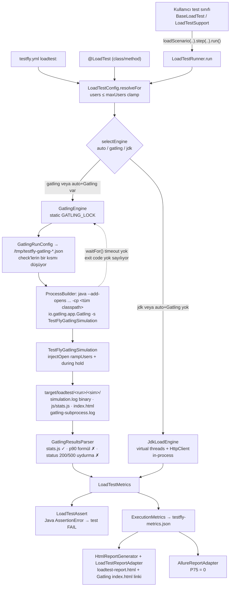
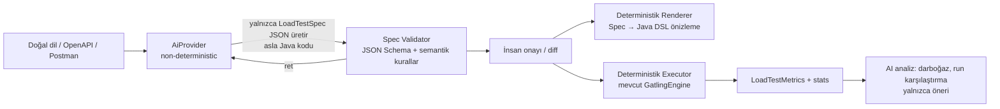
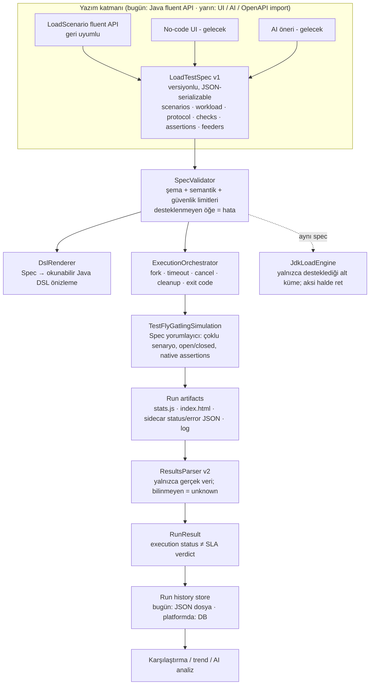

# Gatling Load Testing — Teknik Audit, Architecture Review ve Gap Analysis

| Alan | Değer |
|---|---|
| Tarih | 2026-10-25 |
| Kapsam | `io.testfly.loadtest` (21 sınıf, 3.726 satır), ilgili config/raporlama, 22 test sınıfı |
| Proje Gatling sürümü | **3.13.5** (`pom.xml:233-256`, 4 artefakt, `<optional>true</optional>`) |
| Güncel Gatling | **3.16** (docs.gatling.io "What's new" listesinin en üstü) — proje 3 minor sürüm geride |
| Çalışma ortamı | OpenJDK 21.0.12, Maven 3.9.11, Linux. Yük yalnızca `127.0.0.1` üzerindeki lokal JDK `HttpServer`'a gönderildi. **Düzeltme:** audit koşularında Gatling'in varsayılan HTTP warm-up'ı her koşu başında `gatling.io`'ya bir bağlantı açıyordu (yük değil, tek warm-up isteği). Bu, remediation turunda tespit edilip kapatıldı (bkz. Bölüm 8, R-11). |
| Uygulama kodu değişikliği | Audit aşamasında **yok**. P0 düzeltmeleri sonraki remediation turunda yapıldı; sonuçlar **Bölüm 8**'de. |

**Kanıt sınıflandırması:** **[KOD]** kaynak koddan kesin · **[ÇALIŞTIRMA]** gerçek Gatling/JDK çalıştırmasıyla doğrulandı · **[ÇIKARIM]** kod + doküman üzerinden akıl yürütme, çalıştırılmadı · **[DOĞRULANAMADI]** bu ortamda doğrulanamadı.

---

## 0. Kapsamla ilgili kritik ön tespit

Görev tanımı bir **UI + Backend API + veritabanı + execution servisi** varsayıyor. Repository'de bunların hiçbiri yok **[KOD]**:

- TestFly bir **Java 21 / Maven SDK'sı**. Load testing, kullanıcının kendi TestNG/JUnit test JVM'inde çalışan bir **fluent Java API** (`loadScenario(...).step(...).run()`) olarak sunuluyor.
- Load Testing için frontend yok. `docs-site/` yalnızca Docusaurus dokümantasyonu, `tools/vscode-mobile-inspector/` ise mobil araç.
- Backend REST API, veritabanı, job queue, PID tablosu, kullanıcı/tenant modeli de yok.
- "Test saklama" yalnızca kullanıcının Java kaynak kodu. Sonuçlar `target/loadtest/` altına dosya olarak ve `testfly-metrics.json` içine yazılıyor.

Bu yüzden Bölüm 3'teki (No-Code Builder) ve Bölüm 5'teki (multi-tenant, auth bypass, SSRF) maddelerin çoğu **mevcut sistem için MISSING ya da NOT APPLICABLE**. Raporun geri kalanı **gerçekte var olan SDK'yı** Gatling standartlarına göre değerlendiriyor. Hedef platforma nasıl evrilineceği Bölüm 8'de.

---

## A. Executive Summary

**Gatling gerçekten kullanılıyor, ancak sonuçların bir kısmı uydurma ve modelleme dar.** TestFly, ayrı bir JVM'de gerçek `io.gatling.app.Gatling` çalıştırıyor ve gerçek Gatling HTML raporu üretiyor **[ÇALIŞTIRMA V01, V17]**. Basit akış (smoke, sıralı adımlar, feeder, token korelasyonu) uçtan uca çalışıyor **[ÇALIŞTIRMA V01, V03, V04, V05]**.

En ciddi sorunlar (kullanıcı etkisine göre sıralı):

1. **Status code metrikleri uydurma (Gatling engine).** Gatling 3.13.5 `simulation.log`'u binary yazıyor, parser ise metin satırı arıyor. Sonuçta her OK isteği `200`, her KO isteği `500` olarak raporlanıyor. Sunucu yalnızca `201` döndüğünde TestFly `{200=91}` raporladı; hiç HTTP yanıtı yokken (connection refused) `{500=1924}` raporladı **[ÇALIŞTIRMA V02, V06, V13]**. `assertStatus`/`assertNoStatus` bu yüzden Gatling'de güvenilmez.
2. **JDK engine'de başarısız check ölçümü yok ediyor.** Check, `AssertionError` fırlatıyor; döngü ise yalnızca `Exception` yakalıyor. Başarısız check'i olan sanal kullanıcı sessizce ölüyor ve istek hiç sayılmıyor: 3 istek gönderildi, `total=0, errorRate=0.0` raporlandı **[ÇALIŞTIRMA Probe]**. `assertErrorRateBelow` bu durumda **yanlış PASS** veriyor.
3. **Check'lerin çoğu Gatling'e aktarılmıyor.** `status().in(...)`, `matches(regex)` ve `HEADER_PRESENT` Gatling simülasyonuna hiç gitmiyor. HTTP 200 dönen ama iş sonucu başarısız olan istek başarılı sayılıyor **[ÇALIŞTIRMA V07, V08]**.
4. **p90 ölçülmüyor, hesaplanıyor.** Değer `p50 + (p95-p50)*0.8` formülünden geliyor **[ÇALIŞTIRMA V10]**. Allure'daki P75 de her zaman 0, çünkü alan modelde yok **[KOD]**.
5. **İptal edilen test orphan Java süreci bırakıyor.** Çağıran thread interrupt edildiğinde Gatling child JVM yük üretmeye devam ediyor, hatta ana JVM çıktıktan sonra da sürüyor. `waitFor()` için timeout yok **[ÇALIŞTIRMA Probe]**.
6. **Workload modeli tek kalıba sıkışmış.** Yalnızca `rampUsers(n).during(rampUp)` + `during(hold)` destekleniyor. Closed model, arrival-rate, step/stress profilleri yok. `cooldown` iki engine'de de yok sayılıyor. Dokümanda "concurrent virtual users" denen `users` değeri gerçek eşzamanlılığı garanti etmiyor: `users(10)` ile ölçülen tepe eşzamanlılık 5 **[ÇALIŞTIRMA V11, V12]**.
7. **`auto` modu sessizce engine değiştiriyor.** Aynı test, classpath'e göre farklı semantikle (JDK ya da Gatling) koşuyor ve farklı sonuç veriyor **[KOD + ÇALIŞTIRMA V07/V08 farkları]**.

**Genel değerlendirme:** Gatling entegrasyonu "çalışan prototip" olgunluğunda. Güvenilir metrik ve CI kararı (P0) çözülmeden üzerine no-code/AI katmanı kurulması önerilmez.

---

## 1. Mevcut Sistem Keşfi — Sorulara kod üzerinden cevaplar

| # | Soru | Cevap | Kanıt |
|---|---|---|---|
| 1 | Mimari nasıl çalışıyor? | Fluent builder → `LoadTestRunner.run` → `LoadTestConfig.resolveFor` (YAML < class `@LoadTest` < method `@LoadTest` < fluent) → `selectEngine` → `GatlingEngine` veya `JdkLoadEngine` → `LoadTestMetrics` → `LoadTestAssert` + `ExecutionMetrics.recordLoadTest` → HTML/Allure rapor | `LoadTestRunner.java:51-71, 98-117`; `LoadTestConfig.java:58-127` |
| 2 | Gerçek Gatling runtime ve Java DSL? | **Evet.** `TestFlyGatlingSimulation extends io.gatling.javaapi.core.Simulation` ve `CoreDsl`/`HttpDsl` kullanıyor. Child JVM'de `io.gatling.app.Gatling -s ... -rf ...` çalışıyor | `TestFlyGatlingSimulation.java:26-65`; `GatlingEngine.java:137-157`; **[ÇALIŞTIRMA]** subprocess log'u "Simulation ... completed" diyor |
| 3 | Dependency / Maven plugin doğru mu? | **Kısmen.** 4 Gatling artefaktı `optional` olarak tanımlı, bu doğru (consumer'a zorlanmıyor). `gatling-maven-plugin` yok, çünkü engine Gatling'i doğrudan main class ile başlatıyor. Bu çalışıyor ama Gatling'in desteklediği giriş noktası değil. Hata mesajı consumer'a yalnızca `gatling-charts-highcharts` eklemesini söylüyor; bu artefakt transitif olarak app/http'yi getiriyor mu, doğrulanmadı | `pom.xml:233-256`; `GatlingBridge.java:58-68` **[DOĞRULANAMADI: consumer projede yalnızca highcharts ile çalıştırma]** |
| 4 | Testler nasıl saklanıyor? | Kullanıcının Java test sınıfı olarak. Kalıcı spec modeli, DB veya API yok | — |
| 5 | Konfigürasyondan Simulation nasıl oluşuyor? | `GatlingRunConfig` (Jackson POJO) → geçici JSON dosyası → child JVM'de `-Dtestfly.gatling.config` → `TestFlyGatlingSimulation` instance initializer bunu okuyup DSL'i **runtime'da** kuruyor | `GatlingRunConfig.java:48-110, 124-130`; `GatlingEngine.java:130-141`; `TestFlyGatlingSimulation.java:28-65` |
| 6 | Simulation dinamik mi üretiliyor? | **Hayır; sabit tek bir sınıf** veri-güdümlü yorumlayıcı gibi çalışıyor. Java kaynak kodu üretilmiyor, derlenmiyor, önizlenmiyor | `TestFlyGatlingSimulation.java` |
| 7 | Başlatma / izleme / durdurma? | Başlatma senkron `ProcessBuilder.start()` + `waitFor()`. Canlı izleme yok (stdout dosyaya gidiyor). Durdurma API'si yok. Interrupt edilirse child kill edilmiyor | `GatlingEngine.java:153-158` **[ÇALIŞTIRMA Probe]** |
| 8 | Sonuçlar gerçek Gatling çıktısına mı dayanıyor? | **Kısmen.** Sayımlar, min/max/mean, p50/p95/p99 ve RPS gerçek `js/stats.js`'den okunuyor. **p90, status code dağılımı ve duration türetilmiş veya uydurma** | `GatlingResultsParser.java:126-150, 175-183` **[ÇALIŞTIRMA V02, V10]** |
| 9 | Backend–UI metrik tutarlılığı? | UI yok. TestFly HTML raporu ile Gatling HTML raporu karşılaştırıldığında status code ve p90 farklı. Allure P75 her zaman 0 | `AllureReportAdapter.java:341` (`p75LatencyMs` alanı `LoadTestMetrics`'te yok) |
| 10 | Çalışıyor gibi görünen ama işlevsiz özellikler? | `formParam`, `status().in`, `matches`, `cooldown`, `requestTimeoutSeconds` (Gatling'de), `HEADER_PRESENT`, `jsonPath(..).is(n)`, `runGatlingInProcess`, `mapToJson` | Bölüm D |

### 1.1 Bileşen haritası

| Dosya | Sorumluluk | Not |
|---|---|---|
| `loadtest/LoadScenario.java` | Fluent senaryo builder (`@TestFlyApi 1.1.0`) | Public API, binary uyumluluk korunmalı |
| `loadtest/LoadStep.java` | HTTP adımı, header/body/check/extract | `formParam` işlevsiz |
| `loadtest/CheckCondition.java` | Check modeli (5 tip) | Builder semantiği hatalı |
| `loadtest/LoadTestConfig.java` | 4 katmanlı config çözümleme | Sessiz `maxUsers` clamp |
| `loadtest/LoadTestRunner.java` | Engine seçimi + çalıştırma | `auto` modu sessiz fallback yapıyor |
| `loadtest/LoadTestAssert.java` | Post-hoc SLA assertion'ları (Java tarafında) | Gatling native assertion kullanılmıyor |
| `loadtest/LoadTestFeeder.java` | csv/json/random/uuid/sequence/constant | Sadece circular; queue/shuffle yok |
| `internal/GatlingEngine.java` | Fork, kilit, sonuç parse | Timeout/kill yok |
| `internal/GatlingRunConfig.java` | Config → JSON köprüsü | Check'lerin çoğunu düşürüyor |
| `internal/TestFlyGatlingSimulation.java` | Runtime DSL kurulumu | Tek injection profili |
| `internal/GatlingResultsParser.java` | `stats.js` + `simulation.log` parse | Binary log desteklenmiyor |
| `internal/JdkLoadEngine.java` | Virtual-thread fallback engine | `AssertionError` kaçağı |
| `LoadTestReportAdapter.java`, `HtmlReportGenerator`, `AllureReportAdapter`, `ExecutionMetrics` | Raporlama | P75 kırık |

---

## B. Current Architecture

---

## C. Gatling Feature Parity Matrix

Durum: IMPLEMENTED · PARTIAL · BROKEN · MISSING · NOT APPLICABLE · NOT VERIFIED

### C.1 Simulation & Scenario

| ID | Feature | Gatling Reference | Status | Code Evidence | Priority |
|---|---|---|---|---|---|
| F-01 | `Simulation` + `setUp()` | [Simulation](https://docs.gatling.io/reference/script/core/simulation/) | IMPLEMENTED (sabit sınıf) | `TestFlyGatlingSimulation.java:26,61-64` · V01 | — |
| F-02 | Çok adımlı scenario (`exec` zinciri) | [Scenario](https://docs.gatling.io/reference/script/core/scenario/) | IMPLEMENTED | `:67-101` · V03 | — |
| F-03 | Aynı Simulation'da birden fazla scenario | Simulation `setUp(scnA.inject.., scnB.inject..)` | MISSING | `:61-64` tek `scn` | P1 |
| F-04 | Senaryo başına farklı yük profili | — | MISSING | — | P1 |
| F-05 | `pause` (sabit / min-max) | Scenario › pause | IMPLEMENTED | `:87-93` | — |
| F-06 | `repeat`, `forever`, `asLongAs`, `doIf`, `doIfOrElse`, `randomSwitch`, `tryMax`, `group` | Scenario › loops / conditions | MISSING | Yalnızca dış `during(hold)` döngüsü var `:56-58` | P2 |
| F-07 | Reusable ChainBuilder / composition | — | MISSING (public API'de yok) | — | P2 |
| F-08 | `before()` / `after()` hook'ları | Simulation hooks | MISSING | — | P2 |
| F-09 | Java DSL kod üretimi + derleme + önizleme | — | MISSING | Runtime yorumlayıcı var, kod üretimi yok | P1 |
| F-10 | `maxDuration`, `throttle`, `pace` | Simulation / Scenario | MISSING | — | P1 |

### C.2 Workload Models & Injection

| ID | Feature | Gatling Reference | Status | Code Evidence | Priority |
|---|---|---|---|---|---|
| W-01 | `rampUsers().during()` | [Injection](https://docs.gatling.io/concepts/injection/) | IMPLEMENTED (tek profil) | `:62-63` | — |
| W-02 | `atOnceUsers`, `nothingFor`, `constantUsersPerSec`, `rampUsersPerSec`, `stressPeakUsers`, `incrementUsersPerSec` | Open model | MISSING | — | P1 |
| W-03 | `constantConcurrentUsers`, `rampConcurrentUsers`, `incrementConcurrentUsers` | Closed model | MISSING | — | P1 |
| W-04 | Open/closed karışımını engelleme | "They must all be of the model kind" | NOT APPLICABLE (tek profil) | — | P1 (eklenince) |
| W-05 | `users` = eşzamanlı kullanıcı semantiği | Arrival ≠ concurrency | **BROKEN** | `users(10)`, ramp=6s, hold=2s → tepe 5 (Gatling) / 4 (JDK) · V12 | P0 |
| W-06 | Ramp-down / `cooldown` | Closed model ramp-down | **BROKEN** (yok sayılıyor) | `GatlingRunConfig.java:54` kopyalanıyor ama Simulation kullanmıyor; JDK'da `:134` yalnızca timeout'a giriyor · V11 | P0 |
| W-07 | Seçilen profil ↔ çalışan DSL birebirliği | — | PARTIAL | DSL önizlemesi yok; `hold` her kullanıcının **kendi** başlangıcından itibaren uygulanıyor (`during(hold)`), toplam süre ramp+hold | P1 |

### C.3 HTTP Protocol

| ID | Feature | Status | Code Evidence | Priority |
|---|---|---|---|---|
| H-01 | baseUrl | IMPLEMENTED | `:48` | — |
| H-02 | GET/POST/PUT/PATCH/DELETE | IMPLEMENTED | `:150-156` | — |
| H-03 | HEAD/OPTIONS/QUERY | MISSING | — | P2 |
| H-04 | Header, query param | IMPLEMENTED | `:159-166` | — |
| H-05 | JSON body | IMPLEMENTED | `:169-171` | — |
| H-06 | XML / text body | **BROKEN** | Her body'ye `.asJson()` uygulanıyor; XML `Content-Type: application/json` ile gidiyor · V18 | P1 |
| H-07 | Form / `formParam` | **BROKEN** (public API var, iki engine de yok sayıyor) | `LoadStep.java:96-99`; `GatlingRunConfig` kopyalamıyor · V19 | P1 |
| H-08 | Multipart | MISSING | — | P2 |
| H-09 | Cookie/session yönetimi | IMPLEMENTED (Gatling varsayılan per-VU cookie jar) / MISSING (JDK) | [ÇIKARIM] | — |
| H-10 | Basic/Digest auth DSL | MISSING (header ile elle yapılabilir) | — | P2 |
| H-11 | Bearer/JWT korelasyonu | IMPLEMENTED | V03 (69 auth OK, 0 fail) | — |
| H-12 | OAuth2 token akışı | PARTIAL (login adımı + extract ile elle) | — | P2 |
| H-13 | Redirect | Gatling varsayılan (follow) [ÇIKARIM]; yapılandırılamıyor | — | P3 |
| H-14 | Proxy / TLS / mTLS | MISSING | — | P2 |
| H-15 | Connection pooling (`shareConnections`) | MISSING | — | P3 |
| H-16 | Request timeout | **BROKEN** (Gatling'de) | `requestTimeoutSeconds` `GatlingRunConfig.java:55`'te taşınıyor, Simulation'da kullanılmıyor | P1 |
| H-17 | Request adlandırma / `group()` | PARTIAL (adım adı = request adı; group yok) | `:151` | P2 |
| H-18 | Sabit `Accept: application/json`, `User-Agent: TestFly-LoadTest/1.0` | — | `:49-50` (override edilemiyor) | P2 |
| H-19 | WebSocket / SSE / gRPC / MQTT | MISSING | WS ve SSE Gatling Community'de var. gRPC ve MQTT eklentileri Enterprise aboneliği olmadan 5 dakika sınırlı ([Gatling community](https://community.gatling.io/t/what-are-the-limitation-of-gatling-open-source-compared-to-gatling-entreprise-edition-with-the-java-api/9800)) | P3 |

### C.4 Checks, Assertions & Correlation

| ID | Feature | Status | Code Evidence | Priority |
|---|---|---|---|---|
| K-01 | `status().is(n)` | IMPLEMENTED | `GatlingRunConfig.java:102-103` · V06 | — |
| K-02 | `status().in(...)` | **BROKEN** (Gatling'e aktarılmıyor) | `:101-107` yalnızca STATUS_IS ve JSON_EXISTS'i eşliyor · V07 | P0 |
| K-03 | `jsonPath(..).exists()` | IMPLEMENTED | `:104-105` | — |
| K-04 | JSONPath değer eşitliği (`is`, `in`) | **BROKEN** | `CheckCondition.Builder.is()` hedefi yok sayıp her zaman `STATUS_IS` üretiyor (`CheckCondition.java:59-61`); `jsonPath("$.id").is(5)` "status == 5" oluyor · V09 | P0 |
| K-05 | Body regex `matches` | **BROKEN** (Gatling'de düşüyor; JDK'da AssertionError kaçağı) | V08 | P0 |
| K-06 | Header check | MISSING (enum değeri var, builder yok) | `CheckCondition.java:19` | P2 |
| K-07 | XPath / CSS / JMESPath / `bodyString` | MISSING | — | P2 |
| K-08 | `saveAs` / correlation | IMPLEMENTED (yalnızca JSONPath) | `TestFlyGatlingSimulation.java:182-184` · V03 | — |
| K-09 | Gatling native assertions (`global()`, `details()`, `forAll()`) | MISSING | Assertion'lar Java tarafında post-hoc (`LoadTestAssert`) | P1 |
| K-10 | Assertion başarısızlığının teste/CI'ya yansıması | IMPLEMENTED (Java `AssertionError`) | V20 | — |
| K-11 | Gatling exit code'unun değerlendirilmesi | **BROKEN** (yalnızca stderr'e yazılıyor) | `GatlingEngine.java:159-171` | P0 |
| K-12 | HTTP 200 + iş hatası → KO | **BROKEN** | V08 | P0 |

### C.5 Session, Feeders & Dynamic Data

| ID | Feature | Status | Code Evidence | Priority |
|---|---|---|---|---|
| D-01 | Session variables / EL `#{}` | IMPLEMENTED (`${}` → `#{}` dönüşümü) | `:193-197` | — |
| D-02 | CSV feeder | PARTIAL (tırnak içinde virgül desteklenmiyor) | `LoadTestFeeder.java:279-292` · V05 | P2 |
| D-03 | JSON feeder | IMPLEMENTED (dosya bellekte, JSON'a seri hale getirilip child'a gönderiliyor) | `:57-63` | — |
| D-04 | Strateji: circular | IMPLEMENTED (tek seçenek) | `TestFlyGatlingSimulation.java:130-137` | — |
| D-05 | queue / random / shuffle | MISSING | — | P2 |
| D-06 | Veri tükenmesi (queue exhaustion) | NOT APPLICABLE (tükenme modeli yok) | — | P2 |
| D-07 | Birden fazla feeder | MISSING (`feed()` öncekinin üzerine yazıyor) | `LoadScenario.java:164-167` | P2 |
| D-08 | Kullanıcı başına izolasyon | IMPLEMENTED (Gatling session per VU; JDK'da iterasyon başına kopya map) | `JdkLoadEngine.java:162` · V03 | — |
| D-09 | Ortama göre config | PARTIAL (YAML + annotation; profil/env değişken interpolasyonu NOT VERIFIED) | — | P2 |
| D-10 | Özel feeder (`LoadTestFeeder` alt sınıfı) | PARTIAL (Gatling'e en fazla 5.000 kayıt örnekleniyor ve circular oynatılıyor) | `LoadTestFeeder.java:71-84` | P2 |

### C.6 Metrics, Reporting & Analytics

| ID | Feature | Status | Code Evidence | Priority |
|---|---|---|---|---|
| M-01 | min/max/mean | IMPLEMENTED | `GatlingResultsParser.java:132-134` | — |
| M-02 | p50 / p95 / p99 | IMPLEMENTED (percentiles1/3/4 varsayılan Gatling config'iyle 50/95/99; `gatling.conf` değişirse kayar) | `:135-137` | P2 |
| M-03 | p75 | MISSING (Gatling'de `percentiles2` var, okunmuyor); Allure'da **BROKEN** (sabit 0) | `AllureReportAdapter.java:341` | P1 |
| M-04 | p90 | **BROKEN** (formülle uyduruluyor) | `:142` · V10 | P0 |
| M-05 | RPS | IMPLEMENTED (Gatling `meanNumberOfRequestsPerSecond`) | `:138-139` | — |
| M-06 | VU arrival rate vs RPS ayrımı | MISSING | — | P1 |
| M-07 | Active users zaman serisi | MISSING (yalnızca Gatling HTML'de) | — | P2 |
| M-08 | Status code dağılımı | **BROKEN** (Gatling engine) | `:175-183, 275-303` · V02, V13 | P0 |
| M-09 | Hata nedenleri (KO mesajları) | MISSING (`stats.js`'te `errors` var, okunmuyor [ÇIKARIM]) | — | P1 |
| M-10 | Duration | PARTIAL (`total/rps`'ten türetiliyor) | `:147-150` | P2 |
| M-11 | Gatling static HTML | IMPLEMENTED | V17 (31.557 bayt `index.html`) | — |
| M-12 | Test history / run comparison / trend | MISSING (`ExecutionMetrics` önceki loadTests'i merge ediyor ama karşılaştırma yok) | `ExecutionMetrics.java:431-454` | P2 |
| M-13 | Export | PARTIAL (`testfly-metrics.json`) | — | P2 |
| M-14 | Canlı metrik | MISSING | — | P3 |

### C.7 Execution Engine & Runtime

| ID | Feature | Status | Code Evidence | Priority |
|---|---|---|---|---|
| E-01 | Forked JVM, `--add-opens` | IMPLEMENTED | `GatlingEngine.java:137-152` | — |
| E-02 | Çalışma başına sonuç dizini | IMPLEMENTED | `:62-64` · V16 (sonuçlar karışmadı) | — |
| E-03 | Eşzamanlı çalıştırma | PARTIAL (static lock ile **serileştirilmiş**; 2 test 14,3 sn'de sırayla koştu) | `:25,59` · V16 | P2 |
| E-04 | Execution timeout | MISSING | `:158` `waitFor()` | P0 |
| E-05 | Graceful / forced stop | MISSING | — | P0 |
| E-06 | Orphan process temizliği | **BROKEN** | Probe: interrupt sonrası child pid canlı kaldı ve istek atmaya devam etti (156 → 382 istek) | P0 |
| E-07 | Hata yayılımı | PARTIAL | Exit code yok sayılıyor; asıl hata yalnızca stderr'de. Exception mesajı genel ("0 requests were recorded" · V14; interrupt'ta "failed: null") | P0 |
| E-08 | Log | PARTIAL (`gatling-subprocess.log` dosyası; canlı stream yok) | `:154-156` | P2 |
| E-09 | Artifact retention | MISSING (sınırsız birikim) | — | P2 |
| E-10 | Kaynak izolasyonu (heap, CPU) | MISSING (child JVM'e `-Xmx` verilmiyor) | `:137-152` | P2 |
| E-11 | Status durumları (Running/Completed/Failed/Cancelled) | NOT APPLICABLE (senkron çağrı; servis yok) | — | — |

---

## D. Critical Bugs

| ID | Severity | Bug | Root Cause | Affected Files | Fix Recommendation |
|---|---|---|---|---|---|
| BUG-01 | **Critical** | Gatling engine status code dağılımı uydurma: 201 → "200", connection refused → "500" | Gatling 3.13.5'te `simulation.log` binary (`od -c` çıktısı: `\0\0\0\0 006 3.13.5 ...`; dosyada 0 adet `REQUEST` satırı). Parser metin satırı arıyor, bulamayınca OK→200, KO→500 dolduruyor | `GatlingResultsParser.java:175-183, 209-303` | Uydurma fallback'i kaldır: bilinmiyorsa map'i boş bırak ve "unknown" işaretle. Gerçek status dağılımı için simülasyonda `status().saveAs` + per-status sayaç yazan bir `exec` ile sidecar JSON üret **[ÇIKARIM, prototiplenmeli]**. `simulation.log` Gatling'e göre public API değil |
| BUG-02 | **Critical** | JDK engine'de başarısız check VU'yu öldürüyor; istek sayılmıyor; `errorRate=0` | `evaluateCheck` `AssertionError` (Error) fırlatıyor, döngü ise `catch (Exception)` ile yakalıyor; görev executor içinde sessizce ölüyor | `JdkLoadEngine.java:165-183, 349-388` | `catch (Exception \| AssertionError e)` ya da check'lerin boolean dönmesi; fail sayacı; regresyon testi (`status().is(201)` vs 200 → `errorRate==1`) |
| BUG-03 | **Critical** | `status().in`, `matches`, (`HEADER_PRESENT`) Gatling'e aktarılmıyor; HTTP 200 + iş hatası başarılı sayılıyor | `GatlingRunConfig` yalnızca 2 check tipini eşliyor | `GatlingRunConfig.java:101-107`; `TestFlyGatlingSimulation.java:174-180` | Tüm `CheckCondition.Type` değerlerini eşle (`status().in`, `bodyString().transform(..)`/`regex`, `header(..).exists()`). Eşlenemeyen check'te **fail-fast** et |
| BUG-04 | **High** | `jsonPath("$.id").is(5)` status==5 kontrolüne dönüşüyor; `jsonPath(..).matches` hedefi yok sayıyor | `Builder.is/in/matches` `defaultType` ve `target`'ı kullanmıyor | `CheckCondition.java:49-77` | Builder türünü ayır (`StatusCheckBuilder`, `JsonPathCheckBuilder`). Binary uyum için mevcut `Builder` sınıfını koru, yeni tipleri `JSON_EQUALS` vb. ekle |
| BUG-05 | **High** | İptal/interrupt sonrası orphan Gatling JVM; timeout yok | `process.waitFor()` timeout'suz; `InterruptedException`'da `destroy()` yok; shutdown hook yok | `GatlingEngine.java:157-158, 89-97` | `waitFor(maxDuration+grace)`; `finally` içinde `destroy()` → bekle → `destroyForcibly()` + `descendants()`; JVM shutdown hook; Simulation'a `maxDuration` |
| BUG-06 | **High** | p90 ölçülmüyor, formülle uyduruluyor; P75 Allure'da hep 0 | Gatling varsayılan percentile'ları 50/75/95/99; p90 yok | `GatlingResultsParser.java:142`; `AllureReportAdapter.java:341` | Gatling raporu yalnızca **4 percentile slotu** sunar (`percentiles1..4`, varsayılan 50/75/95/99); p90'ı bir slota koymak başka bir percentile'ı (p75 veya p95) düşürür, bu yüzden p75 ve p90 aynı anda `stats.js`'ten alınamaz. Önerilen: (a) varsayılan slotları koru, `percentiles2`'yi p75 olarak oku (yeni uyumlu accessor) ve p90'ı "ölçülmedi" olarak işaretle; ya da (b) p50/p75/p90/p95/p99'un hepsi gerekiyorsa bunları simülasyon içinden yazılan ham yanıt süresi sidecar'ından (P0-1 ile aynı mekanizma) hesapla. Slot ayarı child JVM'e system property olarak geçirilebilir **[ÇIKARIM: anahtar adı 3.13.5'te doğrulanmalı]** |
| BUG-07 | **High** | `cooldown` iki engine'de de yok sayılıyor; `users` eşzamanlılık garantisi değil | Tek `rampUsers` profili; hold kullanıcı başına | `TestFlyGatlingSimulation.java:56-64`; `JdkLoadEngine.java:134-151` | Açık workload model API'si (Bölüm 8). Mevcut `users/rampUp/hold` korunup closed model'e eşlenebilir: `rampConcurrentUsers(0).to(n).during(ramp)` → `constantConcurrentUsers(n).during(hold)` → `rampConcurrentUsers(n).to(0).during(cooldown)` |
| BUG-08 | **High** | Gatling exit code yok sayılıyor; çökme nedeni exception mesajında yok | `exitCode != 0` yalnızca loglanıyor | `GatlingEngine.java:159-171, 82-93` | Non-zero exit + boş sonuç → log tail'ini exception mesajına ekle. Native assertion'lar eklendiğinde exit code 2'yi "assertion fail" olarak ayır **[ÇIKARIM: Gatling exit code değerleri doğrulanmalı]** |
| BUG-09 | Medium | `formParam` iki engine'de de işlevsiz | Hiçbir engine okumuyor | `LoadStep.java:96-99`; `GatlingRunConfig.java:81-109`; `JdkLoadEngine.java:278-343` | `formParam` → Gatling `.formParam()`, JDK `application/x-www-form-urlencoded` |
| BUG-10 | Medium | Her body `asJson()` ile gidiyor | Sabit kod | `TestFlyGatlingSimulation.java:170` | Kullanıcı `Content-Type` verdiyse ona uy; `asJson` yalnızca Map/JSON body'de |
| BUG-11 | Medium | Gatling'de request timeout uygulanmıyor | Alan taşınıyor, kullanılmıyor | `GatlingRunConfig.java:55`; `TestFlyGatlingSimulation.java` | `requestTimeout` uygula (per-request DSL ya da `gatling.http.requestTimeout` system property) **[ÇIKARIM: 3.13.5 API'si javap ile doğrulanmalı]** |
| BUG-12 | Medium | `auto` engine seçimi sessizce semantik değiştiriyor | Classpath'e bağlı fallback | `LoadTestRunner.java:108-112`; log seçilen engine'i değil config değerini yazıyor (`:58-59`) | Seçilen engine'i logla ve `metrics.engine`'de raporla (zaten var). Check eşleme farkı giderilene kadar `auto` için uyarı ver |
| BUG-13 | Medium | Header/body/feeder verisi (token'lar) içeren geçici config dosyası | `File.createTempFile` POSIX'te umask izinleriyle oluşur (ör. 0644); `Files.createTempFile` 0600 kullanır | `GatlingEngine.java:130` | `Files.createTempFile` + `PosixFilePermissions` 0600 |
| BUG-14 | Low | JDK engine: query param URL-encode edilmiyor, `toJson` escape eksik, naive JSONPath | El yapımı yardımcılar | `JdkLoadEngine.java:404-413, 439-515` | Jackson (zaten bağımlılık) + `URLEncoder` |
| BUG-15 | Low | Ölü kod | Kullanılmayan metotlar | `GatlingEngine.runGatlingInProcess` (`:104-121`), `TestFlyGatlingSimulation.mapToJson` (`:202-224`), `RandomFeeder.random` alanı (`LoadTestFeeder.java:137`) | Kaldır |
| BUG-16 | Low | Sessiz `maxUsers` clamp | Uyarı yok | `LoadTestConfig.java:91-93, 124` | WARN logla |
| BUG-17 | Test gap | Entegrasyon testi 201 dönen endpoint'te yalnızca `assertNoStatus(500)` yapıyor; BUG-01'i yakalamıyor | — | `GatlingEngineIntegrationTest.java:145-165` | `statusCodes().containsKey(201)` assertion'ı ekle; V02/V07/V08 benzeri regresyon testleri |

---

## E. UI/UX Findings (No-Code / Low-Code Builder Audit)

Ürünün hedeflediği 15 adımlı kullanıcı akışı için **ekran mevcut değil**. Aşağıdaki tablo her adımın bugünkü SDK karşılığını gösteriyor:

| # | Hedef adım | Bugünkü karşılık | Durum | Not |
|---|---|---|---|---|
| 1 | Yeni Load Test oluştur | Java sınıfı yaz | MISSING (no-code) | — |
| 2 | Test tipi (Smoke/Load/Stress/Spike/Soak/Capacity) | Yok; yalnızca users/rampUp/hold | MISSING | Tipler, workload preset'lerine (Bölüm 8) eşlenmeli |
| 3 | Base URL | `baseUrl(...)`, YAML, `@LoadTest` | IMPLEMENTED (kodla) | Allowlist/doğrulama yok |
| 4 | HTTP isteği / API akışı | `.step().get/post...` | PARTIAL | HEAD/OPTIONS, form, multipart yok |
| 5 | Header, auth, body | `header`, `body` | PARTIAL | Auth DSL yok; XML yanlış content-type ile gidiyor |
| 6 | Değişkenler / korelasyon | `extract("token","$.x")`, `${var}` | PARTIAL | Yalnızca JSONPath; header/regex extraction yok |
| 7 | Open/Closed model seçimi | Yok | MISSING | — |
| 8 | Injection profile | Tek ramp | MISSING | — |
| 9 | Checks & Assertions | Kısmi; bazıları sessizce düşüyor | BROKEN | Fail-fast olmadan no-code kullanıcı yanıltılır |
| 10 | Java DSL önizleme | Yok | MISSING | — |
| 11 | Çalıştır | `run()` (senkron) | IMPLEMENTED | — |
| 12 | Canlı izleme | Yok | MISSING | — |
| 13 | Sonuç analizi | `LoadTestAssert`, TestFly HTML sekmesi | PARTIAL | p90/status code güvenilmez |
| 14 | HTML rapor | Gatling `index.html` yolu loglanıyor ve TestFly raporundan linkleniyor | IMPLEMENTED | `HtmlReportGenerator.java:582-623` |
| 15 | Önceki run'larla karşılaştırma | Yok | MISSING | — |

**Terminoloji sorunları (API/doküman):**
- `users` dokümanda "concurrent virtual users" (`LoadTest.java:50`), ama Gatling'de `rampUsers` bir **arrival** sayısı. Kullanıcı tepe eşzamanlılığı yanlış yorumlar (V12).
- `cooldown` dokümanda "gradual user removal" (`LoadTest.java:67`, `docs-site/docs/loadtest/configuration.md:45`); uygulamada etkisiz.
- `docs-site/docs/loadtest/reporting.md:21` "P50, P75, P90..." grafiği vaat ediyor; P75 modelde yok, P90 uyduruluyor. EN/TR dokümanlar birlikte düzeltilmeli.
- `docs-site/docs/loadtest/fluent-api.md:62` `formParam`'ı destekli gibi listeliyor.

**Bir no-code arayüz yapılırsa zorunlu UX kuralları:** Tüm alanlar tek bir şema ile doğrulanmalı. Desteklenmeyen kombinasyon (ör. open + closed adımı aynı profilde) kaydetme anında reddedilmeli. Önizleme gerçekten çalışacak DSL'in ta kendisi olmalı. "Arrival rate (users/sec)" ile "Concurrent users" farklı kontrol olarak gösterilmeli ve RPS ayrı bir çıktı olarak etiketlenmeli.

---

## 4. AI-Assisted Load Test Generation

**Mevcut altyapı [KOD]:** `io.testfly.ai` paketinde `AiProvider` (`String call(apiKey, model, prompt, timeoutSeconds)`), `ClaudeProvider`, `GeminiProvider`, `OpenAiCompatibleProvider` ve `AiProviderRegistry` var. Bunlar şu an self-healing ve failure analysis için kullanılıyor. Load testing'e bağlı değil.

**Önerilen ayrım:**

- **AI asla Java kodu üretip çalıştırmamalı.** Çıktısı, şemayla sınırlı `LoadTestSpec` JSON'u olmalı. Böylece syntax/derleme/kod-enjeksiyonu riski tasarım gereği ortadan kalkar; mevcut "sabit Simulation + veri" mimarisi buna hazır (avantaj).
- **Doğrulama zinciri:** JSON Schema → semantik kurallar (model karışımı, max users/rate/duration limitleri, host allowlist, değişken referanslarının tanımlı olması) → kuru render (DSL önizleme) → kısa smoke koşusu (1 VU, 1 iterasyon) → tam koşu.
- **OpenAPI/Postman import** AI gerektirmez; deterministik importer (repo'da `swagger-parser` test-scope'ta zaten var) spec iskeleti üretir, AI yalnızca check/assertion ve korelasyon önerir.
- **Önkoşul:** P0 düzeltmeleri. Uydurma metrikler üzerinde AI analizi yanlış sonuç üretir.

---

## 5. Architecture & Security Review

| Risk | Mevcut durum | Seviye | Kanıt / Not |
|---|---|---|---|
| User-controlled code execution | SDK kullanıcının kendi JVM'inde kendi kodunu çalıştırıyor; uzak giriş yok | N/A (bugün) / **Kritik (platform olursa)** | Platform hiçbir zaman kullanıcı/AI Java kodu derlememeli (Bölüm 4) |
| Command / shell injection | `ProcessBuilder(List)`, shell yok; `-rd` açıklaması sanitize ediliyor | Düşük | `GatlingEngine.java:137-152` |
| SSRF / unsafe URL | baseUrl serbest; allowlist yok | N/A (SDK) / Yüksek (platform) | Platformda egress allowlist + private IP engeli şart |
| Secrets leakage | Token'lar geçici JSON'da (umask izinli); Gatling log'u debug'da body/header yazabilir | Orta | BUG-13 |
| Unrestricted load | `maxUsers` (varsayılan 1000) yalnızca users'ı sınırlıyor; süre ve rate sınırı yok | Orta | `LoadTestConfig.java:91-93` |
| CPU/RAM exhaustion | Child JVM'e heap limiti yok; tüm test classpath'i (Selenium vb.) child'a geçiyor | Orta | `GatlingEngine.java:143` |
| Disk | `target/loadtest` sınırsız; her run ~MB'lar | Düşük | — |
| Orphan process | **Doğrulandı** | Yüksek | BUG-05 |
| Multi-tenant / report leakage / authz | Kavram yok | N/A | — |
| Race conditions | Static lock nedeniyle güvenli ama serileştirilmiş; `GatlingRunConfig.CURRENT` static ama yalnızca ölü in-process yolda kullanılıyor | Düşük | V16 |
| Thread-confinement (CLAUDE.md invariant) | `LoadTestRunner` ThreadLocal; JDK engine paylaşımlı concurrent yapılar | Uyumlu | — |

**Queue / worker gereksinimi:** Bugünkü SDK kullanım modeli (test içinden senkron `run()`) için job queue **gereksiz**. Forked JVM zaten süreç izolasyonu sağlıyor. Ayrı bir execution worker + queue ancak çok kullanıcılı bir web platformu kurulursa gerekli.

---

## 6. Gatling Community vs Enterprise

| Özellik | Community (bu projede) | Enterprise gerekir mi? | Kendi platformumuzda geliştirilebilir mi? | Ek maliyet |
|---|---|---|---|---|
| Lokal çalıştırma | ✔ (kullanılıyor) | Hayır | — | — |
| Static HTML rapor | ✔ (kullanılıyor) | Hayır | — | — |
| Native assertions + exit code | ✔ (kullanılmıyor) | Hayır | Evet, P1 | Yok |
| WebSocket / SSE / JMS / JDBC | ✔ | Hayır | Evet | Yok |
| gRPC / MQTT eklentileri | Enterprise aboneliği olmadan 5 dakika süre sınırı ([community.gatling.io](https://community.gatling.io/t/what-are-the-limitation-of-gatling-open-source-compared-to-gatling-entreprise-edition-with-the-java-api/9800)) | Uzun koşu için evet | Hayır (lisans kısıtı) | Lisans |
| Distributed load generation | ✘ | Evet (yönetilen) | Kısmen: N bağımsız Gatling JVM'i (repo'da `docs-site/docs/loadtest/distributed-docker-k8s.md` bu yaklaşımı anlatıyor) + sonuçları kendi tarafımızda birleştirme. Percentile'lar ancak ham veriyle birleştirilebilir | Orkestrasyon + altyapı |
| Live/real-time reporting | ✘ (Graphite writer 3.12'de kaldırıldı — topluluk raporu, [kaynak](https://community.gatling.io/t/alternatives-for-real-time-analysis-in-version-3-12-0/9421)) | Evet | Kısmen: simülasyon içinden kendi sayaçlarımızı akıtarak | Orta |
| Trends / run comparison / advanced analytics | ✘ | Evet | Evet: `LoadTestMetrics` geçmişi + karşılaştırma | Depolama |
| Merkezi test/sonuç yönetimi, takım özellikleri | ✘ | Evet ([gatling.io/faq](https://gatling.io/faq)) | Evet (platform işi) | Yüksek |
| Enterprise API | ✘ | Evet | NOT APPLICABLE | — |

**Not:** Java SDK iki sürümde de aynı. Community'de olmayan bir özelliği Gatling motorunda varmış gibi varsaymak yanlış olur. Live reporting ve trend bu SDK'da sıfırdan yazılmalı.

---

## 7. Real Execution Validation

**Ortam:** Gatling 3.13.5, JDK 21, `127.0.0.1` üzerinde JDK `HttpServer` (`/ok`, `/created`(201), `/bizfail`(200 + `success:false`), `/login`, `/secure`, `/conc`(200 ms, eşzamanlılık sayacı), `/echo`, `/form`). Harness repo kodunu değiştirmeden public API'yi kullanıyor: `harness/AuditHarness.java`, `harness/Probe.java`, ham çıktı `harness/harness-run.log`. **PASS = beklenen (doğru) davranış gözlendi.**

Ayrıca mevcut test paketleri çalıştırıldı: `GatlingEngineIntegrationTest` (3), `GatlingResultsParserTest` (5), `GatlingBridgeTest` (2), `EngineSelectionTest` (10), `LoadScenarioBuilderTest` (11), `LoadTestAssertTest` (36), `PercentileCalculatorTest` (8), `JdkLoadEngineTest` (24) — **99/99 geçti**. Bu testler BUG-01/02/03'ü yakalamıyor.

| ID | Amaç | Yapılandırma | Beklenen | Gerçek | Sonuç | Kanıt |
|---|---|---|---|---|---|---|
| V01 | Basit HTTP smoke | GET /ok, 3 users, ramp 1s, hold 2s | Tüm istekler OK, engine=gatling | 134 istek, 0 KO, sunucu 134 hit | **PASS** | metrics ↔ server hit eşit |
| V02 | Status code doğruluğu | POST /created (yalnızca 201) | statusCodes={201:n} | `{200=91}` | **FAIL** | BUG-01 |
| V03 | Correlation (token extract → Bearer) | login → secure | 0 adet 401 | authOk=69, authFail=0 | **PASS** | — |
| V04 | Sequence feeder | `/echo?id=${id}` | Benzersiz ID'ler | 136 farklı ID, literal placeholder yok | **PASS** | — |
| V05 | CSV feeder | `loadtest/users.csv` | 3 kullanıcı adı görülsün | `[alice, bob, charlie]` | **PASS** | — |
| V06 | Başarısız check (status) | /ok + `status().is(201)` | errorRate=1 | errorRate=1.0, ama status `{500=90}` (sunucu 200 döndü) | **PASS** (check) / status kaydı yanlış | BUG-01 |
| V07 | `status().in(200,204)` vs 201 | gatling ve jdk | errorRate=1 | gatling 0.0, jdk 0.0 | **FAIL** | BUG-03 (gatling), BUG-02 (jdk) |
| V08 | HTTP 200 + iş hatası | /bizfail + body regex check | errorRate=1 | gatling 0.0, jdk 0.0 | **FAIL** | BUG-03, BUG-02 |
| V09 | `jsonPath("$.id").is(5)` | /created | JSON değer kontrolü | Status==5 kontrolüne dönüştü, `{500=45}` | **FAIL** | BUG-04 |
| V10 | p90 ölçümü | /conc | Ölçülmüş p90 | p90=245,4 = p50+(p95−p50)·0,8 | **FAIL** | BUG-06 |
| V11 | Cooldown | ramp 1s, hold 2s, cooldown 8s | ~11 sn yük | gatling 3.000 ms, jdk 3.041 ms | **FAIL** | BUG-07 |
| V12 | `users` = eşzamanlılık | users 10, ramp 6s, hold 2s | Tepe ≈10 | gatling 5, jdk 4 | **FAIL** | W-05 |
| V13 | Runtime failure (bağlantı reddi) | baseUrl `127.0.0.1:1` | KO, status "yok" | 1.924 KO, `{500=1924}` | **FAIL** (status uydurma) | BUG-01 |
| V14 | Simülasyon kurulum hatası (bozuk EL `${unclosed`) | — | Anlamlı hata mesajı | "0 requests were recorded… Check console logs" | **FAIL** | BUG-08 |
| V15 | İptal (thread interrupt) | hold 30s, 6. sn'de interrupt | Child JVM sonlansın | Child canlı; istekler 156 → 382 arttı; ana JVM çıktıktan sonra da yaşadı (elle `pkill`) | **FAIL** | BUG-05 (harness'in ilk V15 "PASS"i komut satırı filtresi yüzünden yanlış pozitifti; `Probe cancel` ile düzeltildi) |
| V16 | Eşzamanlı çalıştırma | 2 thread | Sonuçlar karışmasın | İzole (`[ok0]` / `[ok1]`), serileştirilmiş, 14,3 sn | **PASS** (izolasyon) | E-03 |
| V17 | HTML rapor | — | `index.html` | 31.557 bayt | **PASS** | — |
| V18 | XML body | `<order>…` | `Content-Type: xml/text` | `application/json` | **FAIL** | BUG-10 |
| V19 | Form param | `formParam(user,alice)` | URL-encoded body | Body boş, iki engine'de de | **FAIL** | BUG-09 |
| V20 | Assertion fail → test fail | `assertP95Below(50)` (p95≈245) | AssertionError | Fırlatıldı | **PASS** | — |
| V-JDK | JDK başarısız check | `status().is(201)` vs 200 | errorRate=1 | 3 istek gitti, total=0, errorRate=0 | **FAIL** | BUG-02 |
| — | Open workload (diğer profiller) | — | — | Desteklenmiyor | **NOT VERIFIED (MISSING)** | W-02 |
| — | Closed workload | — | — | Desteklenmiyor | **NOT VERIFIED (MISSING)** | W-03 |
| — | Ramp-down | — | — | Desteklenmiyor | **NOT VERIFIED (MISSING)** | W-06 |
| — | Simulation **compile** failure | — | — | Kod üretimi/derleme yok | **NOT APPLICABLE** | F-09 |
| — | Frontend–backend tutarlılığı | — | — | UI/backend yok | **NOT APPLICABLE** | Bölüm 0 |
| — | TLS/proxy, uzun koşu, yüksek yük | — | — | Bu ortamda çalıştırılmadı | **NOT VERIFIED** | — |

**Doğrulanmayan iddialar:** consumer projede yalnızca `gatling-charts-highcharts` ile çalışma; Gatling exit code değerleri; 3.14–3.16 upgrade breaking change'leri; Gatling percentile config anahtarları.

---

## F. Recommended Target Architecture

**İlke:** Çalışan "sabit Simulation + veri" yaklaşımını koru ve güçlendir. Kod üretimi yalnızca **önizleme** amaçlı olsun. Platform (UI/API/DB) ayrı bir ürün katmanı olarak, aynı spec sözleşmesini kullanarak sonradan eklenebilir.

**Modül sorumlulukları:**
- **`LoadTestSpec`** (yeni, `internal` ile başlayıp olgunlaşınca `@TestFlyApi`): `GatlingRunConfig`'in genişletilmiş, versiyonlu hali. Tek sözleşme olarak fluent API, UI ve AI tarafından üretilir.
- **`SpecValidator`:** Her engine'in desteklediği yetenek kümesini (`capabilities`) bilir. JDK'nın desteklemediği check ya da profil "sessiz düşürme" yerine hata verir. Böylece BUG-03 ve BUG-12 sınıfı sorunlar kalıcı olarak kapanır.
- **`DslRenderer`:** Spec'ten derlenebilir Java DSL metni üretir (önizleme ve "Gatling projesine export" için). Tutarlılık testi: render edilen kod derlenip aynı spec ile yorumlayıcıya karşı karşılaştırılır.
- **`ExecutionOrchestrator`:** `GatlingEngine`'in süreç yönetimi kısmı. Timeout, iptal, shutdown hook, heap limiti, minimum classpath ve log tail'i burada toplanır.
- **`RunResult`:** `LoadTestMetrics` + `executionStatus` (COMPLETED/FAILED/CANCELLED/TIMED_OUT) + `slaVerdict` (PASSED/FAILED/NOT_EVALUATED) + `dataQuality` (hangi alanların ölçülmüş/bilinmiyor olduğu). Yarım kalan koşu tamamlanmış gibi raporlanamaz.
- **Queue:** Yalnızca web platformu kurulduğunda. O zaman `ExecutionOrchestrator`, ayrı worker sürecinde aynı sınıfla çalışır. Dağıtık çalıştırma için spec'te `injectorCount` ve sonuç birleştirme (ham histogram gerektirir) ileride eklenir.

**Uyumluluk:** `LoadScenario`, `LoadStep`, `CheckCondition`, `LoadTestMetrics` `@TestFlyApi(since="1.1.0")`. Tüm değişiklikler ekleme şeklinde yapılmalı: yeni metotlar, yeni enum değerleri, record'a alan eklemek yerine yeni accessor/yan tip. `scripts/agent/verify.sh api` ile kontrol edilmeli.

---

## G. Implementation Roadmap

### P0 — Critical (metrik güvenilirliği ve süreç güvenliği)

| Task ID | Açıklama | Mevcut sorun | Teknik çözüm | Etkilenen dosyalar | Bağımlılık | Acceptance Criteria | Test / Validation |
|---|---|---|---|---|---|---|---|
| P0-1 | Uydurma status code'ları kaldır | BUG-01 | OK→200 / KO→500 fallback'ini sil. Metin `simulation.log` parse'ını 3.10+ için devre dışı bırak. Simülasyonda status sayan sidecar JSON üret (prototip) | `GatlingResultsParser`, `TestFlyGatlingSimulation`, `GatlingEngine` | — | 201 dönen endpoint → `{201:n}`. Bağlantı hatası 500 olarak raporlanmaz | V02, V13 entegrasyon testine taşınır |
| P0-2 | JDK check hatası sayımı | BUG-02 | `AssertionError`'ı yakala ya da check'i boolean yap; KO say, VU'yu öldürme | `JdkLoadEngine:165-183` | — | Başarısız check → errorRate=1; VU iterasyona devam eder | V-JDK unit testi |
| P0-3 | Check eşlemesini tamamla + fail-fast | BUG-03, BUG-04 | Tüm tipleri Gatling DSL'e eşle. Eşlenemeyen check'te `IllegalArgumentException`. `CheckCondition` builder'ını tipine göre düzelt (yeni tipler, eski API korunur) | `GatlingRunConfig`, `TestFlyGatlingSimulation`, `CheckCondition` | — | V07, V08, V09 iki engine'de errorRate=1 | Parametrik engine-parity testi |
| P0-4 | Süreç yaşam döngüsü | BUG-05, BUG-08 | `waitFor(timeout)`, `destroy`/`destroyForcibly` + descendants, shutdown hook, exit code + log tail'i exception mesajına | `GatlingEngine` | — | Interrupt sonrası ≤5 sn içinde child yok. Bozuk EL hatası mesajda görünür | V14, V15 entegrasyon testi (`ProcessHandle` ile) |
| P0-5 | p90 dürüstlüğü + P75 | BUG-06 | Varsayılan 4 slotu (50/75/95/99) koru: p75'i `percentiles2`'den oku, p90'ı "ölçülmedi" işaretle. p90 zorunluysa tüm percentile'ları ham yanıt süresi sidecar'ından hesapla (slot değiştirmek p75 veya p95'i kaybettirir) | `GatlingResultsParser`, `LoadTestMetrics` (ek accessor), `AllureReportAdapter` | P0-1 | Rapor ve Gatling HTML aynı p-değerlerini gösterir | V10, stats.js fixture testi |
| P0-6 | Yük semantiğini düzelt | BUG-07, W-05 | `users/rampUp/hold/cooldown`'u closed model'e eşle (Bölüm D BUG-07). Dokümanı EN/TR güncelle | `TestFlyGatlingSimulation`, `JdkLoadEngine`, docs | P0-3 | V12 tepe ≈ users. V11 süre ≈ ramp+hold+cooldown | Server-side eşzamanlılık sayacı testi |

### P1 — Core Features

| Task ID | Açıklama | Teknik çözüm | Etkilenen dosyalar | Bağımlılık | Acceptance Criteria | Test |
|---|---|---|---|---|---|---|
| P1-1 | `LoadTestSpec` v1 + `SpecValidator` | `GatlingRunConfig`'i versiyonlu spec'e dönüştür; engine capability matrisi | yeni `internal/spec/*` | P0 | Desteklenmeyen öğe her engine'de açık hata | Şema + golden JSON testleri |
| P1-2 | Workload API (open + closed) | `workload().open(...)`/`.closed(...)` builder'ları, karışımı engelle | `LoadScenario` (ekleme), Simulation | P1-1 | 7 open + 3 closed adım çalışır; karışım reddedilir | Her adım için kısa entegrasyon koşusu |
| P1-3 | Çoklu senaryo / Simulation | `loadSimulation().scenario(a, profileA).scenario(b, profileB)` | yeni API, Simulation | P1-2 | Senaryo başı metrik | Entegrasyon |
| P1-4 | Native Gatling assertions | `LoadTestAssert` SLA'larını spec'e de yaz ve Simulation'da `assertions(...)` olarak uygula. Exit code → `slaVerdict` | Simulation, `GatlingEngine`, `RunResult` | P0-4 | Assertion fail = Gatling exit ≠0 = TestFly FAIL, tutarlı | V20 varyantları |
| P1-5 | HTTP tamamlama | formParam, content-type, HEAD/OPTIONS, request timeout, override edilebilir protocol header'ları | `LoadStep`, Simulation, JDK | P1-1 | V18, V19 PASS | Entegrasyon |
| P1-6 | `RunResult` ve veri kalitesi | execution status ≠ SLA verdict; ölçülmemiş alanlar işaretli | yeni tip, raporlar | P0-1, P0-5 | Yarım koşu "COMPLETED" görünmez | Unit |
| P1-7 | Hata nedenleri ve RPS/arrival ayrımı | `stats.js`/sidecar'dan KO mesajları; spec'ten arrival rate | Parser, rapor | P0-1 | Top-N hata mesajı raporda | Fixture |
| P1-8 | Gatling 3.16'ya yükseltme | 3.13→3.14→3.15→3.16 upgrade guide'larını uygula | `pom.xml`, `GatlingBridge` mesajı | P0 | Tüm Gatling testleri yeşil | `verify.sh code`, consumer gate |
| P1-9 | DSL önizleme (`DslRenderer`) | Spec → Java kaynak metni | yeni | P1-1 | Render edilen kod derlenir ve aynı metrik yapısını üretir | Derleme testi |

### P2 — Advanced

| Task ID | Açıklama | Acceptance |
|---|---|---|
| P2-1 | Akış kontrolü: `repeat`, `doIf/OrElse`, `randomSwitch`, `group`, `tryMax`, `pace` | Spec'te ve DSL önizlemede birebir |
| P2-2 | Gelişmiş feeder: queue/random/shuffle, çoklu feeder, tükenme davranışı, RFC 4180 CSV | Queue tükenince tanımlı davranış (Gatling: simülasyonu durdurur) |
| P2-3 | Korelasyon: header/regex/XPath/JMESPath extraction ve check'leri | — |
| P2-4 | Run history + karşılaştırma + trend (`testfly-metrics.json` geçmişi, baseline diff) | İki run arasında p95/RPS/errorRate farkı raporda |
| P2-5 | Artifact retention (son N run), child JVM heap limiti, minimal classpath | Disk/RAM sınırları konfigüre edilebilir |
| P2-6 | Eşzamanlı Gatling koşuları (lock yerine izole dizin + sınırlı paralellik) | 2 koşu paralel, sonuçlar izole |
| P2-7 | Auth DSL (basic, OAuth2 client-credentials adımı), proxy/TLS/mTLS | — |
| P2-8 | Dokümantasyon düzeltmeleri (EN/TR parity): users semantiği, cooldown, P75/P90, formParam | `verify.sh docs` yeşil |

### P3 — Platform Enhancements

| Task ID | Açıklama | Not |
|---|---|---|
| P3-1 | No-code UI + Load Test API + DB + worker | Ayrı ürün. P1-1 spec'i sözleşme olarak kullanır; SSRF allowlist, kota, authz zorunlu |
| P3-2 | AI: NL/OpenAPI/Postman → Spec; check/assertion/korelasyon önerisi; sonuç analizi | Yalnızca spec üretir (Bölüm 4) |
| P3-3 | Canlı metrik akışı (simülasyon içi sayaçlar → dosya/stream) | Community'de native değil |
| P3-4 | Dağıtık koşu (K8s Job × N + sonuç birleştirme) | Ham histogram birleştirme gerektirir |
| P3-5 | WebSocket/SSE (Community), gRPC/MQTT (lisans kısıtına dikkat) | — |
| P3-6 | CI entegrasyonu: JUnit XML/SLA özet çıktısı | — |

---

## H. Technical Maturity Score

| Kategori | Puan | Gerekçe (kanıt) |
|---|---|---|
| Gatling Java DSL Compatibility | **5/10** | Gerçek DSL ve runtime (V01). Yalnızca bir injection ve sınırlı DSL alt kümesi; check'ler düşüyor (V07, V08); ölü kod var |
| Execution Reliability | **3/10** | Timeout, cancel ve cleanup yok; orphan doğrulandı (V15). Exit code yok sayılıyor; hata mesajları belirsiz (V14) |
| Workload Modeling Accuracy | **2/10** | Tek profil; cooldown etkisiz (V11); users ≠ eşzamanlılık (V12); closed model yok |
| Scenario Management | **3/10** | Sıralı adımlar + pause çalışıyor (V03). Çoklu senaryo, döngü ve koşul yok |
| HTTP & API Testing | **4/10** | Temel metodlar, header, JSON çalışıyor. Form, XML, timeout ve auth DSL bozuk ya da eksik (V18, V19) |
| Checks & Assertions | **3/10** | `status().is` ve `jsonPath.exists` çalışıyor. Diğerleri sessizce düşüyor; JDK'da check hatası ölçümü siliyor (V-JDK); native assertion yok |
| Feeders & Correlation | **5/10** | sequence/CSV/JSON ve JSONPath korelasyonu çalışıyor (V03-V05). Yalnızca circular; tek feeder |
| Metrics Accuracy | **3/10** | min/mean/max/p50/p95/p99/RPS gerçek. Status code, p90 ve P75 uydurma ya da kırık (V02, V10, V13) |
| Reporting & Analytics | **4/10** | Gatling HTML + TestFly HTML linki çalışıyor (V17). History, karşılaştırma ve hata nedenleri yok |
| UI/UX | **1/10** | No-code UI yok; puan yalnızca fluent API'nin okunabilirliğinden. API terminolojisi yanıltıcı (`users`, `cooldown`) |
| Security | **6/10** (SDK bağlamında) | Shell yok, argümanlar liste halinde. Geçici dosya izinleri, kaynak limitleri ve orphan riskleri var. Platform bağlamında değerlendirilemez |
| Scalability | **3/10** | Tek host; Gatling koşuları JVM içinde serileştirilmiş (V16); dağıtık yok |
| Production Readiness | **3/10** | CI'da kullanılabilir ama P0 bulguları yanlış PASS/yanlış metrik üretiyor |

---

## 8. P0 Remediation Sonuçları (2026-10-25)

Bu bölüm audit'ten sonra yapılan P0 güvenilirlik turunun sonucudur. Yöntem şöyleydi:
1. Önce regresyon testleri yazıldı ve mevcut kodda 32 testin 26'sının başarısız olduğu kanıtlandı.
2. Sonra düzeltmeler yapıldı.
3. Bağımsız bir code review yapıldı ve bulguları düzeltildi.
4. Tüm testler yeniden koşuldu.

Her testte TestFly'ın raporladığı değerler, yerel sunucunun gerçekten gözlemlediği istek sayılarıyla karşılaştırıldı. Workload semantiği için karar: `docs/adr/0003-load-test-workload-model.md`.

### 8.1 Bulgu durumu

| Bulgu | Durum | Kök neden (kesin) | Yeni davranış | Regresyon testi |
|---|---|---|---|---|
| BUG-01 status code uydurma | **FIXED** | Binary `simulation.log` metin olarak okunuyordu; OK→200, KO→500 dolduruluyordu | Simülasyon `transformResponse` ile gerçek status'ları sayıp `testfly-status.json`'a yazar. Yanıtsız istekler `-1` olarak raporlanır. Sidecar yoksa harita boş kalır ve status assertion'ları "not measured" hatası verir. `simulation.log` hiç okunmaz. | `GatlingReliabilityIntegrationTest.statusCodes_*`, `GatlingResultsParserTest` |
| BUG-02 JDK check → AssertionError | **FIXED** | `catch (Exception)` `AssertionError`'ı yakalamıyordu; sanal kullanıcı ölüyordu | Check hatası KO sayılır, programlama hatası koşuyu durdurur, interrupt ve güvenlik timeout'u exception fırlatır | `JdkLoadEngineReliabilityTest` (10), `JdkLoadEngineTest.testInterruptCancelsRunWithException` |
| BUG-03 `status().in`/`matches` düşüyordu | **FIXED** | `GatlingRunConfig` yalnızca 2 check tipini eşliyordu | Tüm tipler iki engine'de eşlenir; eşlenemeyen check fail-fast olur | `EngineParityIntegrationTest` (19) |
| BUG-04 `jsonPath(..).is(n)` → status check | **FIXED** | `Builder` türünü hatırlamıyordu | Yeni `JSON_EQUALS`/`JSON_IN` tipleri JSON değerini karşılaştırır; `status().exists()` exception fırlatır | `LoadScenarioBuilderTest`, parity satırları |
| BUG-05 orphan child JVM | **FIXED** | `waitFor()` için timeout yoktu, interrupt'ta `destroy` çağrılmıyordu | `maxDuration`, `waitFor(maxDuration+120s)`; timeout, interrupt ve JVM kapanışında süreç ağacı önce `destroy`, gerekirse `destroyForcibly` ile sonlandırılır | `GatlingReliabilityIntegrationTest.interrupt_terminatesGatlingChildJvm` (ProcessHandle ile) |
| BUG-06 p90 uydurma / P75 = 0 | **FIXED** | p90 formülle hesaplanıyordu; `p75LatencyMs` alanı modelde yoktu | Gatling'de p90 = `NaN` ("n/a"); p75 `percentiles2`'den okunur; slotlar `-D` ile 50/75/95/99'a sabitlenir; NaN üzerine yapılan assertion başarısız olur | `GatlingResultsParserTest`, `LoadTestAssertTest`, rapor testleri |
| BUG-07 cooldown / users semantiği | **OPEN (ADR-0003)** | Tek open-model profili | Davranış bilinçli olarak değiştirilmedi; dokümante edildi; `cooldown` > 0 için JVM başına bir WARN | — (V11, V12 hâlâ FAIL) |
| BUG-08 exit code yok sayılıyordu | **FIXED** | `exitCode != 0` yalnızca loglanıyordu | Exit code ≠ 0 → exception; mesajda exit code ve maskelenmiş son 20 log satırı | `simulationBuildFailure_reportsExitCode`, `LogRedactorTest` |
| BUG-09 `formParam` işlevsiz | **FIXED** | Hiçbir engine okumuyordu | İki engine'de `application/x-www-form-urlencoded`; body ile birlikte kullanılırsa fail-fast | `JdkLoadEngineReliabilityTest`, `GatlingReliabilityIntegrationTest.formParam_sendsUrlEncodedBody` |
| BUG-10 her body `asJson` | **PARTIAL** | Sabit `.asJson()` | Kullanıcı `Content-Type` verdiyse ona uyulur; vermediyse JSON varsayılır (JDK ile aynı kural). İçerik tipi tahmini yok (V18). | V19 |
| BUG-11 Gatling'de request timeout yok | **FIXED** | Alan taşınıyordu ama kullanılmıyordu | Her istekte `requestTimeout(Duration)` uygulanır | — (kod ve review ile doğrulandı) |
| BUG-12 `auto` sessiz engine değişimi | **FIXED** | Classpath'e bağlı sessiz fallback | Seçilen engine loglanır; JDK'ya fallback'te WARN; `LoadScenarioValidator` engine yeteneklerine göre fail-fast yapar | `LoadScenarioValidatorTest`, parity |
| BUG-13 temp config dosyası izinleri | **FIXED** | `File.createTempFile` umask izinleri kullanıyordu | `rw-------`, `finally` içinde siliniyor | — (kod ve review) |
| BUG-14 JDK URL-encode / JSONPath | **FIXED** | Elle yazılmış yardımcılar | Query değerleri URL-encode edilir; JSONPath Jackson ile çözülür (`$.a.b`, `$.a[0].b`, `$[0]`; `$`'sız yol `$.yol` sayılır); JSON `null` iki engine'de "mevcut" sayılır | `JdkLoadEngineTest`, parity |
| BUG-15 ölü kod | **FIXED** | — | `runGatlingInProcess`, `mapToJson` ve `RandomFeeder.random` kaldırıldı | derleme |
| BUG-16 sessiz `maxUsers` clamp | **OPEN** | — | Bu turda ele alınmadı | — |
| BUG-17 test boşluğu | **FIXED** | — | 3 yeni regresyon sınıfı ve sunucu gözlemine dayalı assertion'lar | — |

### 8.2 Remediation sırasında bulunan ek sorunlar

| ID | Bulgu | Durum |
|---|---|---|
| R-11 | Gatling'in HTTP warm-up isteği her koşuda `gatling.io`'ya bağlanıyordu, analitik de açıktı | **FIXED**: `disableWarmUp()` ve `-Dgatling.data.enableAnalytics=false`. DEBUG probunda 5 koşuda 0 dış bağlantı görüldü. |
| R-12 | ReportPortal, HTML raporu ve Allure NaN veya null değerleri "0 ms" gösteriyordu; status grafiği uydurma bir "200" dilimi çiziyordu | **FIXED**: hepsi "n/a" / "Status codes not measured" gösteriyor |
| R-13 | JDK iptali yarım metrik döndürüyordu (`ConcurrentModificationException` riski) | **FIXED** |
| R-14 | `LogRedactor` tırnaklı değerleri yalnızca kısmen maskeliyordu | **FIXED** |
| R-15 | PR'daki `BlazeDemoLoadTest` sınıfına eklenen sınıf seviyesi `@Test(singleThreaded)`, miras alınan `step(..)` metotlarını test yapıyordu (5 sahte hata) | **FIXED** (geri alındı) |

### 8.3 Gerçek çalıştırma sonuçları (V01–V20, `harness/harness-run.log`)

Sayım senaryo bazındadır. V07, V08, V11, V12 ve V19 her engine için ayrı bir sonuç satırı yazar; bir senaryo, satırlarından biri FAIL ise FAIL sayılır.

| V01–V20 senaryoları | Audit (önce, V15 düzeltilmiş) | Remediation (sonra) |
|---|---|---|
| PASS | 8 (V01, V03–V06, V16, V17, V20) | 17 |
| FAIL | 12 | 3 (V11, V12, V18) |

Ayrıca V-JDK (JDK'da başarısız check) önce FAIL'di, şimdi PASS (`JdkLoadEngineReliabilityTest`). V06 audit'te check sonucu açısından PASS sayılmıştı; status haritası ise yanlıştı (`{500=…}`). Remediation'da harita da doğru (`{200=…}`).

Sonrasında FAIL kalanlar:
- V11 (cooldown, iki engine) ve V12 (users = eşzamanlılık değil, iki engine): ADR-0003 gereği değiştirilmedi.
- V18 (XML body, Content-Type verilmezse JSON olarak gidiyor): P1.

V10 artık PASS çünkü p90 Gatling'de ölçülmüyor ve "n/a" olarak açıkça işaretleniyor; ölçülmüş gibi gösterilmiyor.

### 8.4 Doğrulama kapıları (ana oturumda koşuldu)

| Kapı | Sonuç |
|---|---|
| `scripts/agent/verify.sh api HEAD` (public API + tam unit suite) | API **PASS**; 2036 test, 0 hata |
| `GatlingReliabilityIntegrationTest` / `EngineParityIntegrationTest` / `JdkLoadEngineReliabilityTest` / `GatlingEngineIntegrationTest` | 12/19/10/3, 0 hata |
| Koşulardan sonra artık Gatling child JVM | Yok |
| `check-doc-accuracy.sh`, `check-localization.sh` | PASS |

Koşulmayanlar:
- `verify.sh consumer` (consumer checkout yok)
- `verify.sh release`
- safety-timeout yolu (60 sn'den uzun sürüyor; yalnızca kodla doğrulandı)

### 8.5 Kalan teknik riskler ve P1

- Workload modeli (W-02/W-03/W-05/W-06): ADR-0003, karar 4.
- Redirect sayımı engine'ler arasında farklı. Gatling her hop'u ayrı istek sayar; JDK yalnızca son yanıtı sayar.
- Null değerli bir değişken sonraki adımda kullanılırsa davranış farklı:
  - Gatling isteği hiç göndermez ve istatistiğe yazmaz;
  - JDK geçersiz URI nedeniyle koşuyu durdurur.
- `cooldown` WARN'u varsayılan 5 sn nedeniyle neredeyse her JVM'de bir kez çıkar.
- Gatling sürüm yükseltmesi (3.16) bu turdan bilinçli olarak ayrı tutuldu.
- Content-Type tahmini (V18) ve HEAD/OPTIONS desteği P1'de.

## Kaynaklar

- Gatling — What's new (latest 3.16): https://docs.gatling.io/release-notes/gatling/ , https://docs.gatling.io/release-notes/gatling/whats-new/3.16/
- Gatling — Injection (open/closed models): https://docs.gatling.io/concepts/injection/
- Gatling — Assertions: https://docs.gatling.io/reference/script/core/assertions/
- Gatling — Checks: https://docs.gatling.io/reference/script/core/checks/
- Gatling — Feeders: https://docs.gatling.io/reference/script/core/session/feeders/
- Gatling — Upgrading 3.9→3.10: https://docs.gatling.io/release-notes/upgrading/3.9-to-3.10
- simulation.log formatı / Graphite kaldırılması (topluluk, resmi olmayan): https://community.gatling.io/t/alternatives-for-real-time-analysis-in-version-3-12-0/9421
- OSS vs Enterprise (topluluk yanıtı): https://community.gatling.io/t/what-are-the-limitation-of-gatling-open-source-compared-to-gatling-entreprise-edition-with-the-java-api/9800
- Gatling FAQ (fiyatlandırma / sürüm kapsamı): https://gatling.io/faq

> `simulation.log`'un binary olduğu bu ortamda **doğrudan gözlendi** (`od -c`, 0 adet `REQUEST` satırı). Formatın hangi sürümde değiştiği resmi olarak doğrulanamadı; topluluk kaynakları 3.12 civarını işaret ediyor. Gatling ekibine göre bu dosya public API değil.
