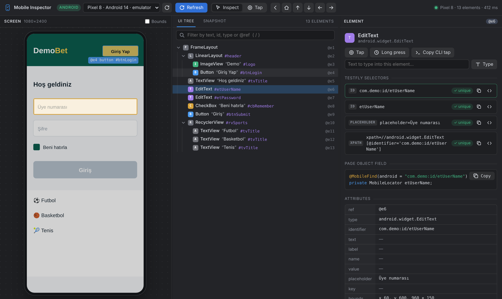

# IntelliJ IDEA için TestFly Mobile Inspector

[VS Code Mobile Inspector](../vscode-mobile-inspector/README_tr.md)'ın IntelliJ tabanlı IDE'ler (2024.1+) için
sürümü: aynı arayüz (`media/` dosyaları eklentiye gömülür), IDE'nin gömülü tarayıcısında (JCEF) çalışır ve
IDE temasına uyar. [English](README.md)



## Kurulum

Settings → Plugins → ⚙ → **Install Plugin from Disk…** → `tools/intellij-mobile-inspector/dist/testfly-mobile-inspector-0.1.4.zip`, ardından IDE'yi yeniden başlatın.

## Kullanım

- Soldaki **TestFly Mobile** penceresi → **Open Mobile Inspector**, ya da **Tools → TestFly: Open Mobile Inspector**. Inspector bir editör sekmesinde açılır.
- Ekran, `@eN` ref'li UI ağacı, Snapshot sekmesi, öğe özellikleri, eşleşme sayılı TestFly seçicileri ve `@MobileFind` alanları, dokunma / uzun basma / yazma / Back / Home / kaydırma: VS Code eklentisindeki gibi. Tuşlar: `R`, `I`, `T`, `/`, `Esc`.
- Settings → Tools → **TestFly Mobile Inspector**: mobilecli sunucu adresi (`http://localhost:12000`), mobilecli yolu, otomatik başlatma, eylemden sonra yenileme.

[mobilecli](https://github.com/mobile-next/mobilecli) ve açık bir simülatör, emülatör veya cihaz gerekir (iOS: bir kez `mobilecli agent install --device <udid>`).

## Derleme

```bash
./gradlew test buildPlugin    # build/distributions/testfly-mobile-inspector-<sürüm>.zip
```

Arayüz `../vscode-mobile-inspector/media/` altındadır; orada değiştirince iki IDE de alır.
